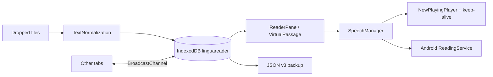
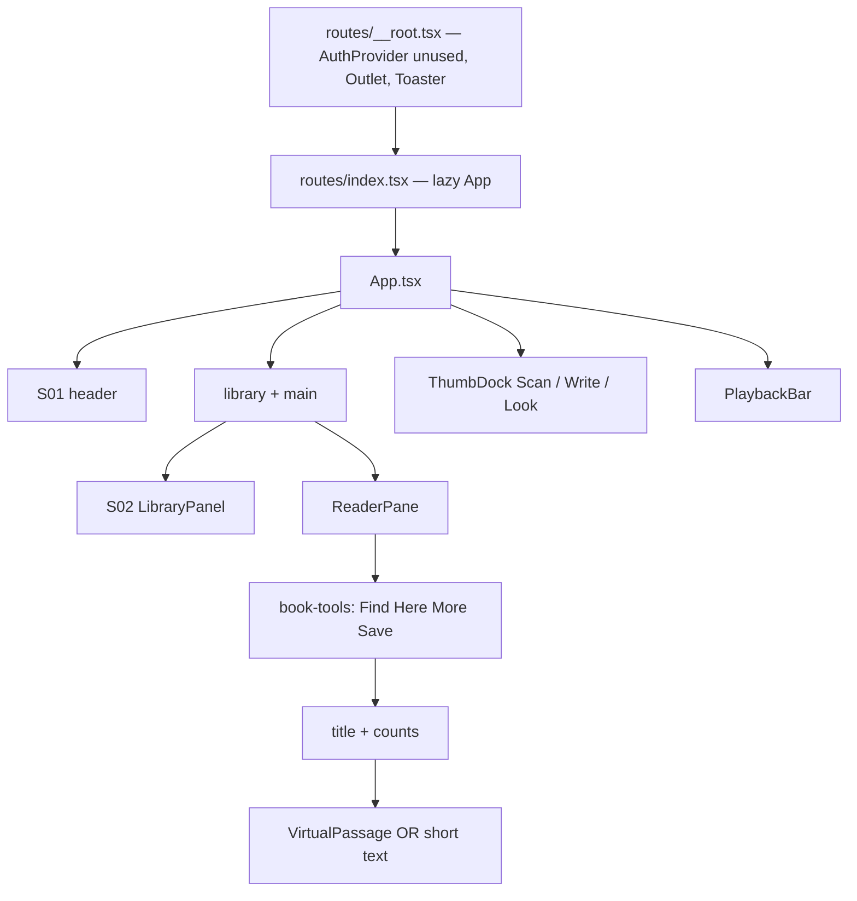

# LinguaReader Application Knowledge Base

**App:** LinguaReader  
**AKB version:** 1.5.12  
**Date:** 2026-09-24  
**applicationId:** `com.linguareader.app` (immutable)  
**IndexedDB:** `linguareader` (immutable identity)

This document is the operational memory of LinguaReader. Update it on every instruction. Do not rewrite past Change Log rows.

---

## Difference vs previous AKB (1.5.10)

| Area | 1.5.10 | 1.5.12 |
|---|---|---|
| Chapters | Fifteen titles at a time, then a Load more button | Every chapter for that book is in one list. Scroll from the first title to the last |
| Jump | Tap a shown chapter | Tap any chapter. Reading starts at that sentence |
| Version | 1.5.10 / 10510 | **1.5.12 / 10512** |

## Difference vs previous AKB (1.5.9)

| Area | 1.5.9 | 1.5.10 |
|---|---|---|
| Wallpaper | Painted on the hidden page behind a solid paper panel, and only after the save finished | Linen, Moss, Dusk, Ink wash, Plain paper, and My photo paint the reading page the moment you tap |
| Custom photo | Waited for the file to be stored, and used a lock-screen style that iPhone often hides | The photo shows at once. A light paper veil keeps the words readable |
| Version | 1.5.9 / 10509 | **1.5.10 / 10510** |

## Difference vs previous AKB (1.5.8)

| Area | 1.5.8 | 1.5.9 |
|---|---|---|
| Roles and mixes | Player had Roles and Mix | Removed on every phone and computer |
| Chapters | None | Each book lists chapters, 15 at a time |
| Voice change | Could ask about a saved mix | The new voice starts at the same sentence immediately |
| Backup | Settings, books, mixes | Settings, books with chapters, storyteller audio clips |
| Version | 1.5.8 / 10508 | **1.5.9 / 10509** |

## Previous difference (1.5.6)

| Area | 1.5.6 | 1.5.8 |
|---|---|---|
| iOS play | Silent keep-alive loop ran on every phone | iOS WebKit unlocks AudioContext on the Play tap and skips the Blink silent loop |
| Android Chrome | Silent keep-alive + speech pulse | **Unchanged** |
| AI helper | None | Optional free key saved only on this device (`aiProvider`, `aiApiKey`, `aiSelectedModel`) |
| Release folder | `dist-apk/client` | `dist-release/LinguaReader-v1.5.12/` |
| Version | 1.5.6 / 10506 | **1.5.8 / 10508** |

---

## System Overview

LinguaReader is a **local-first text-to-speech reader** for Chinese and English novels. It runs as:

- a **Progressive Web App** (Chrome, Safari, Firefox, Edge; iOS Chrome and Android Chrome)
- an **Android APK** (Capacitor WebView + foreground reading service)
- an **iOS Capacitor shell** (background audio keys in Info.plist)

Nothing essential lives in the cloud. Books, progress, voices, mixes, and look-and-feel stay on the device in IndexedDB. Optional online pieces (neural storyteller clips) cache locally after first fetch.

**Who it is for:** a non-technical reader who wants to listen to `.txt` / `.epub` / `.docx` novels (including GB18030 Chinese files) with lock-screen controls, bookmarks, and role-mix voices.

**Non-goals:** accounts, social feed, cloud library, ads, unused Auth/DB scaffolds.



---

## Module Register

| ID | Module | Path | Responsibility |
|---|---|---|---|
| M01 | App shell | `src/App.tsx` | Library load, file ingest, player wiring, chrome hide, auto-follow |
| M02 | Router | `src/router.tsx`, `src/routes/` | Single-page `/` via TanStack Start |
| M03 | Storage | `src/services/StorageService.ts` | IndexedDB, backups v1–v3, settings surfaces |
| M04 | Sync | `src/services/SyncService.ts` | BroadcastChannel across tabs |
| M05 | Speech | `src/services/SpeechManager.ts` | Sentence queue, roles, neural/custom/system TTS |
| M06 | Now playing | `src/services/media/NowPlayingPlayer.ts` | Clip timing, MediaSession, hold pad |
| M07 | Keep-alive | `src/services/media/SessionKeepAlive.ts` | Silent Web Audio so browsers keep playing |
| M08 | Native reading | `src/services/media/NativeReading.ts` + Android Java | Foreground service on APK |
| M09 | Storyteller | `src/services/media/storyteller.ts` | 林华 / 沈言 / Clara / Rowan |
| M10 | Import | `src/services/FileImport.ts` + `documents/` | txt, md, json, epub, docx, pdf, rtf, html |
| M11 | Encoding | `src/utils/textNormalization.ts` | UTF-8/16 BOM, GB18030, GBK |
| M12 | Sentences | `src/utils/sentences.ts` | Paragraph-aware split |
| M13 | Cast | `src/utils/cast.ts` | Role detection + SavedCast |
| M14 | Appearance | `src/lib/appearance.ts` | Theme, font, wallpaper, focus chrome |
| M15 | PWA | `vite.config.ts` + `src/lib/pwa.ts` | Manifest, service worker |
| M16 | Capacitor | `capacitor.config.ts`, `android/`, `ios/` | Native wrappers |
| M18 | Platform | `src/utils/platform.ts` | `isIOS()` / `isAndroid()` only |
| M19 | AI config | `src/components/reader/AIConfigDialog.tsx` | Local free-key form |

---

## Screen Register

LinguaReader is one route (`/`). Screens are **overlays and regions** on that page.

| ID | Screen | Trigger | Primary components |
|---|---|---|---|
| S01 | Reader Home | App open | Header, ReaderPane, PlaybackBar, ThumbDock |
| S02 | Library | Library / Close | LibraryPanel |
| S03 | Look & reach | Palette | AppearanceSheet |
| S04 | Save & restore | Backup | BackupSheet |
| S05 | Resume prompt | Reopen with progress | ResumeDialog |
| S06 | Role mix picker | Roles on | MixPackPickerDialog |
| S07 | Mix choice | Voice change with mix | MixChoiceDialog |
| S08 | Cast editor | Mix | CastDialog |
| S09 | Custom voice | Mic | VoiceDialog |
| S10 | Find | Find | FindBar |
| S11 | Scan | Camera thumb | ScanSheet |
| S12 | Handwrite | Pen thumb | HandwriteSheet |
| S13 | Rename | Title / rename | RenameDialog |
| S14 | Get Android | Android / phone icon | GetAndroidDialog |
| S15 | Confirm delete | Bin | ConfirmDialog |
| S16 | Install PWA | Install button | InstallButton |
| S17 | Free AI helper | Library → Backup → Free AI helper | AIConfigDialog |

---

## Feature Register

| ID | Feature | Default | Notes |
|---|---|---|---|
| F01 | Open txt/md/json/epub/docx/pdf/rtf/html | on | Encoding auto + GB18030 override |
| F02 | IndexedDB library | on | Offline |
| F03 | Last-read resume prompt | on | Skip or jump |
| F04 | Autosave offset | on | On sentence advance + pause/stop |
| F05 | TTS play/pause/skip/stop | on | MediaSession lock screen |
| F06 | Storyteller voices | on | 林华 沈言 Clara Rowan |
| F07 | Role mix | off | Saved as mix packs, not in settings backup only |
| F08 | Custom uploaded voice | opt | Stored as blobs |
| F09 | Auto-Follow Highlight | **on** | Off = never snap; On = pause on scroll, resume next paragraph after 2.5s idle |
| F10 | Show/Hide Chrome | **off** (show) | Session only; reload always shows chrome |
| F11 | Here | — | One-shot jump to current line |
| F12 | Background / lock-screen audio | on | Keep-alive + Android foreground service |
| F13 | Cross-tab sync | on | BroadcastChannel, no network |
| F14 | Typed backups | on | Settings / Library / Mix packs |
| F15 | Full backup JSON v3 | on | SHA-256 digest |
| F16 | PWA install | on | Web only |
| F17 | Android APK download | Android Chrome | `/downloads/LinguaReader.apk` |
| F18 | Night mode, fonts, wallpaper | on | Visual store per desktop/mobile |
| F19 | Scan / handwrite gloss | opt | Camera / canvas |
| F20 | Rename book | on | Display title only |
| F21 | iOS play unlock | iOS only | AudioContext resumed inside the Play tap |
| F22 | Free AI helper key | off | Saved in settingsDesktop / settingsMobile. Not required to read. |

---

## Invariants / Business Rules

These must not be broken.

1. **`applicationId` stays `com.linguareader.app`.** Never rename the Android id.
2. **IndexedDB name stays `linguareader`.** Do not migrate identity.
3. **No required cloud account.** Auth/DB scaffolds stay unused.
4. **Reading position is local.** Swiping the app away must restore the last sentence on that book.
5. **Auto-Follow Highlight Off** never recenters the passage, including iOS Chrome scroll-up.
6. **Show/Hide Chrome** defaults to Show on every reload. Hidden mode is session-only so users cannot get stuck.
7. **Backup JSON v3** always writes `settingsDesktop` and `settingsMobile`.
8. **v1 and v2 backups still import.** Digest math for v2 stays the old canonical payload.
9. **Mix packs** are a separate backup kind from settings and library.
10. **Sample books** may refresh text but must keep the user’s sentence offset.
11. **Neural storyteller** may use the network; playback must still work with system TTS offline.
12. **APK versionName** must match `APP_VERSION`; **versionCode** must increase on every APK.
13. **Android Chrome keep-alive** (silent pad + oscillator) must stay on. iOS must not use that loop.
14. **AI keys** are optional and local. Reading works with `aiProvider: "none"`.

There is **no RNG and no coin table** in this product. Those compliance lines from other apps do not apply, except: do not invent them.

---

## Persistence

### Stores (IndexedDB `linguareader`, schema 11)

| Store | Key | Contents |
|---|---|---|
| documents | `id` | Title, rawText, encoding, offsets, optional sourceBytes |
| meta | `key` | settings, settingsDesktop, settingsMobile, wallpaper, backups, seed |
| progress | `documentId` | sentenceOffset, title, updatedAt |
| voices | `id` | Custom voice blobs |
| ttsCache | `id` | Neural clips |
| casts | `documentId` | SavedCast / BookCast |
| mixPresets | `id` | Role mix packs per narrator |

Also: `localStorage` key `linguareader.resume.v1` for crash-safe resume.

### Visual surfaces

| Surface | Meta key | Chosen when |
|---|---|---|
| desktop | `settingsDesktop` | Pointer is fine, not iOS/Android UA |
| mobile | `settingsMobile` | iOS, Android, or coarse + narrow |
| mirror | `settings` | Last written surface (legacy readers) |

Look (theme, type, wallpaper, control size, hand) can differ per surface. Playback voice/rate and the optional AI key still save on the active surface (`settingsDesktop` or `settingsMobile`).

AI fields inside each settings block: `aiProvider` (`google` | `groq` | `grok` | `none`), `aiApiKey`, `aiSelectedModel`. Default is off.

### Backup JSON v3 (full)

```json
{
  "app": "LinguaReader",
  "version": 3,
  "kind": "linguareader.full-backup",
  "exportedAt": 0,
  "documents": [],
  "settings": {},
  "settingsDesktop": {},
  "settingsMobile": {},
  "progress": [],
  "resume": null,
  "casts": [],
  "voiceBank": [],
  "voices": [],
  "wallpaper": null,
  "digest": "sha256-hex"
}
```

Typed files:

- `linguareader.settings` v3 — settings + settingsDesktop + settingsMobile + wallpaper
- `linguareader.library` — books + progress + resume
- `linguareader.mix-pack` — role mix presets + four storytellers

### SavedCast schema

```ts
interface BookCast {
  documentId: string;
  language: "zh" | "en";
  roles: CastRole[];
  updatedAt: number;
  narratorURI?: string | null; // new
  packId?: string | null;      // new
  surface?: "desktop" | "mobile"; // new
}
```

---

## Integrations

| Integration | Required? | Notes |
|---|---|---|
| Browser `speechSynthesis` | Fallback | System voices |
| Web Audio + HTMLAudioElement | Yes for lock-screen | Keep-alive + clip playback |
| Media Session API | Yes | Lock-screen play/pause/skip |
| BroadcastChannel | Yes | Multi-tab |
| IndexedDB | Yes | Library |
| Capacitor Android | APK | `ReadingService` foreground, `FOREGROUND_SERVICE_MEDIA_PLAYBACK` |
| Capacitor iOS | iOS app | `UIBackgroundModes = audio` |
| Neural TTS (`story-tts`) | Optional online | Cached in `ttsCache` |
| Vite PWA / Workbox | Web | Offline shell |
| Vercel / GitHub Pages | Hosting only | Static files |
| Auth / Postgres | **Off** | Do not enable |

---

## Impact Matrix

| Change | M01 App | M03 Storage | M05 Speech | S01 Reader | S02 Library | S04 Backup | APK |
|---|---|---|---|---|---|---|---|
| Encoding / import | • | • | | • | • | | |
| Resume / autosave | • | • | • | • | | | |
| Auto-follow | • | • | | • | | | |
| Chrome hide | • | | | • | | | |
| Role mix | • | • | • | | | • | |
| Backup v3 | | • | | | | • | |
| Background audio | | | • | | | | • |
| Visual surface split | • | • | | • | | • | |

---

## Troubleshooting

| Symptom | Likely cause | Fix |
|---|---|---|
| Mojibake on Chinese txt | Wrong encoding | Use GB18030 / GBK control, keep sourceBytes |
| Play stops ~1s or at lock | Browser suspended TTS | Keep-alive + MediaSession; APK uses foreground service |
| Repeats last sentence | Queue cleared / index rewind | Do not `cancel()` the whole queue on pause; persist offset |
| Reads half a sentence | Utterance timeout too short | Native timeout vs web; do not skip on keep-alive ticks |
| No 林华 / only 沈言 | Clip fetch / iOS vs Chrome cache | Storyteller cache; Mix off uses selected voice |
| Highlights ≠ audio | Follow vs virtual window | Auto-Follow off must not `scrollIntoView` the window |
| iOS Chrome snap-back | Page scroll + prepend jump | Book pane is the only scroller; restore prepend by anchor |
| APK blank / shows 1.2.0 | Stale or unsigned web assets | Rebuild, validate versionName, uninstall old APK |
| Fetching voice forever | Neural hang on WebView | 5s native timeout, fall back to one neural |
| Close button under home bar | Sheet not using safe-area | Dialog sheet + svh + sticky X |
| iOS Chrome silent or blocked on Play | WebKit autoplay | Play tap must create and resume AudioContext before speech |
| Android Chrome stopped after an iOS fix | Keep-alive removed for everyone | Silent loop must stay on when `isIOS()` is false |

---

## AI Maintenance

When Grok (or another agent) receives a new instruction:

1. Read this AKB and `docs/AKB-PROTOCOL.md`.
2. Classify: bug, feature, persist, native, or packaging.
3. Touch only listed modules. Do not enable Auth/DB. Do not change `applicationId`.
4. Bump version if behavior or a binary changes.
5. Append a Change Log row.
6. Refresh AKB `.md` + `.docx`, APK, and source ZIP to the **same** version.
7. Write the difference table at the top of the new AKB.

Use the templates below for the Change Log description.

---

## Change Log

Append-only.

| Version | Date | Changes | Modules | Screens | Cross-engine | Tests |
|---|---|---|---|---|---|---|
| 1.5.12 | 2026-09-24 | Chapter lists no longer stop at 15. Opening chapters shows the full list in one scroll. Tapping a title still jumps to that sentence. | Library | S02 Library | Same drawer on WebKit and Blink | Open a long novel, scroll to the last chapter, tap it |
| 1.5.10 | 2026-09-23 | Wallpaper modes apply on the reading page immediately, including a custom photo. No reload. Same behavior on iOS, Android, and desktop. | Appearance, App shell, styles | S03 Look | WebKit and Blink: background is on the visible page, not behind it. No background-attachment:fixed. | Tap each wallpaper with the sheet open and confirm the page behind changes before Done |
| 1.5.9 | 2026-09-23 | Removed roles, mixes, and character casting on every platform. Chapter list under each book, 15 at a time. Voice dropdown hot-swaps without a prompt. Backups include chapter marks and the local storyteller clip cache. Offline missing clips fall back to the phone voice. | Speech, Storage, Library, Playback | S01, S02, S04 | WebKit and Blink share the same player path | Open a numbered Chinese novel, jump to chapter 16; switch 林华 to 沈言 while playing; restore a voice backup offline |
| 1.5.8 | 2026-09-23 | iOS Play unlocks WebKit AudioContext inside the tap. iOS skips the Blink silent keep-alive loop. Android Chrome path unchanged. Free AI helper key saved locally in both visual stores. Release folder `dist-release/LinguaReader-v1.5.8/`. | M05, M07, M18, M19, M03 | S02, S17, S01 | WebKit: AudioContext on Play, no silent loop. Blink: keep-alive unchanged. | Play on iOS Chrome starts voice; Android Chrome still plays past lock; AI off still reads; APK 1.5.8 / 10508 |
| 1.5.6 | 2026-09-20 | Baseline AKB (md+docx). Backup JSON **v3** with `settingsDesktop` + `settingsMobile`. SavedCast gains `narratorURI`, `packId`, `surface`. APK copied to `dist-apk/client`. Source ZIP. | M03, M13, M16 | S04 | Both | Import v1, v2, v3 backups; desktop vs mobile settings do not overwrite each other; APK versionName 1.5.6 / versionCode 10506 |
| 1.5.5 | 2026-09-20 | iOS Chrome scroll-up no longer snaps to highlight. Book pane is the only scroller. No `scrollIntoView` on the window. Prepend keeps an anchor line. | M01, reader VirtualPassage | S01 | iOS Chrome Auto-Follow **off**, scroll up/down while paused and playing |
| 1.5.4 | 2026-09-20 | Auto-Follow Highlight toggle. Default on. Manual scroll suspends immediately. Resume only on next paragraph after 2.5s idle. Here is one-shot. | M01, PlaybackBar, ReaderPane | S01 | Toggle off never snaps; toggle on idle follow |
| 1.5.3 | 2026-09-20 | Show/Hide Chrome on the player. Default Show. Session-only. Reload always shows chrome. | M01, PlaybackBar | S01 | Reload cannot stay hidden |
| 1.5.2 | 2026-09-20 | Keep-alive + Android foreground reading; hide chrome while playing (later reversed to session toggle) | M05–M08 | S01 | Lock screen > 2:30 |
| 1.2.0–1.5.1 | 2026-09 | Encoding, mix packs, backups, APK packaging, PWA, Capacitor | many | many | Historical product path |

---

## Templates

### New Feature

```
Goal:
Screen(s):
Module(s):
Default on/off:
Persistence (desktop / mobile / neither):
Backup impact (v3 fields):
Tests:
AKB sections to update: Feature Register, Screen Register, Impact Matrix, Change Log
```

### Bug

```
Symptom:
Platform (iOS Chrome / Android Chrome / APK / Safari):
Expected:
Invariant at risk:
Fix module:
Regression tests:
```

### Persist

```
Store / key:
Desktop vs mobile:
Backup kind (settings / library / mix-pack / full v3):
Migration from v1/v2:
Identity unchanged? (DB name, applicationId)
```

### Native / API

```
Android permission / service:
iOS Info.plist / audio session:
Web fallback:
Must work offline? 
Do not add Auth/DB unless named in the ask.
```

---

## Visual Layouts

Desktop emphasis. Mobile stacks the same regions; the library becomes a full-screen sheet.

### Component hierarchy



### S01 Reader Home (desktop)

```
┌──────────────────────────────────────────────────────────────────────────┐
│ HEADER  [logo LinguaReader v]  [Find] [Type+] [Night] [Look] [Install] [Library]
├──────────────┬───────────────────────────────────────────────────────────┤
│ LIBRARY      │ book-tools:  [Find] [Here] [More ▾] [Save book]     28%   │
│ (md: 18rem)  │───────────────────────────────────────────────────────────│
│ books list   │ TITLE (tap to rename)                                     │
│ + import     │ n characters                                              │
│ + backup     │                                                           │
│              │  PASSAGE (only vertical scroller)                         │
│              │  highlight = current sentence                             │
│              │                                      [Scan]  thumb dock   │
│              │                                      [Write]              │
│              │                                      [Look]               │
├──────────────┴───────────────────────────────────────────────────────────┤
│ PLAYER  [Lib] [Play] title/line [Here] [Show/Hide Chrome ☐] [▴]         │
│         skip  stop  index                                                │
│         rate slider                                                      │
│         [voice dropdown] [Roles] [Mix] [Mic]                             │
│         Auto-Follow Highlight ☑                                          │
│         Show/Hide Chrome ☐                                               │
└──────────────────────────────────────────────────────────────────────────┘
```

Header row: logo + version, Find, larger type, night, look, install/Android, Library.  
Filter/tools row: Find, Here, More (encoding, rename, share, delete), Save book, progress badge.  
NOTE pane: none — the passage itself is the reading surface.  
Sidebars: Library (left, desktop), ThumbDock (right).  
Toggles: Auto-Follow Highlight, Show/Hide Chrome, Roles, Mix, night.

### S02 Library

```
┌─────────────────────────────┐
│ Library            [Close]  │
│ [Open a file]               │
│ Backup ▾                    │
│   [Free AI helper]          │
│   [Save & restore]          │
│ [Get Android app]           │
│─────────────────────────────│
│ book card  title            │
│            % · encoding     │
│            [rename] [bin]   │
│ … scrollable list …         │
└─────────────────────────────┘
```

### S03 Look & reach

```
┌─────────────────────────────────┐
│ Look & reach              [X]   │
│ Theme:  Paper | Night           │
│ Font:   Serif Sans Kai Song     │
│ Accent: Pine Clay Indigo Plum   │
│ Size:   Compact Comfortable Large│
│ Hand:   Right | Left            │
│ Wallpaper…                      │
│                          [Done] │
└─────────────────────────────────┘
```

Chrome-while-reading is **not** here (moved to the player so reload cannot hide chrome).

### S04 Save & restore

```
┌─────────────────────────────────┐
│ Save & restore            [X]   │
│ Android phone app  [Download APK]│
│ [App settings]   save | restore │
│ [Library of books]              │
│ [Roles mix packs]               │
│ [Restore a file] [Delete copies]│
│ Close is sticky above home bar  │
└─────────────────────────────────┘
```

### S05 Resume

```
┌─────────────────────────────────┐
│ Continue 仙逆?                  │
│ Last place  28%                 │
│ [Skip]            [Continue]    │
└─────────────────────────────────┘
```

### Player options (expanded)

| Control | Type | Default |
|---|---|---|
| Play / Pause | button | — |
| Here | button | jump once |
| Show/Hide Chrome | switch | Off = show |
| Auto-Follow Highlight | switch | On |
| Rate | slider 0.6–1.8 | 1.0 (user persisted) |
| Voice | dropdown | last / storyteller |
| Roles | toggle | Off |
| Mix | button | disabled unless Roles on |
| Mic | button | custom voice |

### ThumbDock

Right edge, above the player: Scan (camera), Write, Look. Hidden when Show/Hide Chrome is On.

---

### S17 Free AI helper

```
┌──────────────────────────────────────────┐
│ Free AI helper                           │
│ Key stays on this device.                │
│ Provider [ Off | Google | Groq | Grok ]  │
│ hint + link to the free key page         │
│ API key  [ password field ]              │
│ Model    [ dropdown ]                    │
│                     [Cancel] [Save]      │
└──────────────────────────────────────────┘
```

Desktop and phone use the same sheet. The saved key goes into the active surface (`settingsDesktop` or `settingsMobile`).

---

## Build & release outputs (v1.5.10)

| Channel | How | Output |
|---|---|---|
| Web PWA | `npm run build` | `dist/` + service worker |
| Android APK | `npm run pack:android` | signed, versionCode **10509**, v1+v2+v3 |
| Release pack | `dist-release/LinguaReader-v1.5.12/` | AKB, APK, `dist-web/`, source zip, iOS config zip |
| Source | `scripts/pack-source.mjs` | `LinguaReader-v1.5.9-source.zip` |

Signing (Android): keystore `android/app/linguareader.jks`, alias `linguareader`. Do not change the applicationId.

---

*End of AKB v1.5.12*
