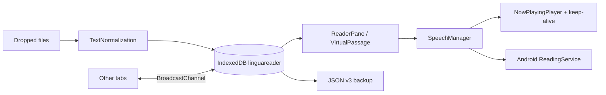
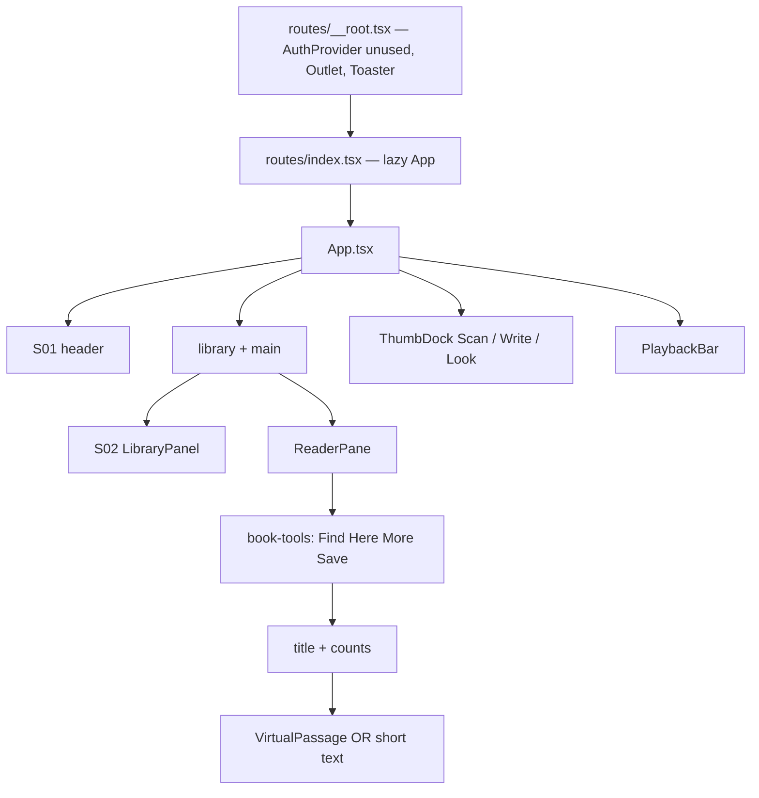

# LinguaReader Application Knowledge Base

**App:** LinguaReader  
**AKB version:** 1.5.41  
**Date:** 2026-09-24  
**applicationId:** `com.linguareader.app` (immutable)  
**IndexedDB:** `linguareader` (immutable identity)

This document is the operational memory of LinguaReader. Update it on every instruction. Do not rewrite past Change Log rows.

---

## Difference vs previous AKB (1.5.40)

| Area | 1.5.40 | 1.5.41 |
|---|---|---|
| Phone voices | Tingting and Sinji made no sound. The play tap was still changing the phone’s audio route and cancelling speech | Play now speaks straight away with the phone’s own voice. Nothing else is allowed to cancel that speech |
| Version | 1.5.40 / 10540 | **1.5.41 / 10541** |

## Difference vs previous AKB (1.5.39)

| Area | 1.5.39 | 1.5.40 |
|---|---|---|
| Phone voices | A low background tone was all that could be heard; Tingting and Sinji were covered | That tone is turned off. Phone voices speak on their own again |
| Version | 1.5.39 / 10539 | **1.5.40 / 10540** |

## Difference vs previous AKB (1.5.38)

| Area | 1.5.38 | 1.5.39 |
|---|---|---|
| Phone voices in the background | The iPhone stopped them on the lock screen because nothing was registered as playing media | Phone voices now keep a real audio hold, the same idea as YouTube, so the lock screen and app switch can keep them going |
| Version | 1.5.38 / 10538 | **1.5.39 / 10539** |

## Difference vs previous AKB (1.5.37)

| Area | 1.5.37 | 1.5.38 |
|---|---|---|
| Phone voices | A quiet background tone cut Tingting and Sinji off after one word and kept them in the earpiece | That tone no longer plays while a phone voice is reading. The phone is asked to use the loudspeaker, the same route as the four storytellers |
| Version | 1.5.37 / 10537 | **1.5.38 / 10538** |

## Difference vs previous AKB (1.5.36)

| Area | 1.5.36 | 1.5.37 |
|---|---|---|
| Phone voices | Tingting, Daniel, Samantha, and the other phone voices stopped when the screen locked or Chrome was switched away | Those voices now keep a quiet audio hold, the same kind the four storytellers use, so reading continues on the lock screen and in the background |
| Version | 1.5.36 / 10536 | **1.5.37 / 10537** |

## Difference vs previous AKB (1.5.35)

| Area | 1.5.35 | 1.5.36 |
|---|---|---|
| Clara and Rowan | The iPhone paused itself in the gap after a paragraph, so reading stopped | That automatic pause is ignored, and the next sentence starts |
| Version | 1.5.35 / 10535 | **1.5.36 / 10536** |

## Difference vs previous AKB (1.5.34)

| Area | 1.5.34 | 1.5.35 |
|---|---|---|
| Clara and Rowan | A paragraph could end and reading stopped | The end of a paragraph now starts the next sentence |
| Other languages | Removing extra English voices also removed every other language | Other languages are back. English phone voices remain only Daniel and Samantha |
| Version | 1.5.34 / 10534 | **1.5.35 / 10535** |

## Difference vs previous AKB (1.5.33)

| Area | 1.5.33 | 1.5.34 |
|---|---|---|
| Storyteller loudness | 林华, 沈言, Clara, and Rowan were quieter than the phone voices | Those four are boosted to about the same loudness as the phone voices |
| English phone voices | Every English phone voice was listed | Only Daniel (English) and Samantha (English) remain |
| Daniel and Samantha | A Chinese page swapped them for another voice, and the menu could fall back to Storyteller | The chosen phone voice is kept, including while switching from the menu |
| Clara and Rowan | A paragraph could repeat while the highlight moved on | A clip is not treated as finished until most of it has played |
| Version | 1.5.33 / 10533 | **1.5.34 / 10534** |

## Difference vs previous AKB (1.5.32)

| Area | 1.5.32 | 1.5.33 |
|---|---|---|
| 沈言 | The highlight moved on, but the iPhone kept playing the previous paragraph | The old clip is stopped before the next one is loaded, and a repeated clip is not played again |
| 林华, Tingting, Meijia | Working | Left as they are |
| Version | 1.5.32 / 10532 | **1.5.33 / 10533** |

## Difference vs previous AKB (1.5.31)

| Area | 1.5.31 | 1.5.32 |
|---|---|---|
| Tingting | Waited a long time after a sentence, and the storyteller could take over as 林华 | The next sentence starts when she finishes. The storyteller no longer starts while a phone voice is selected |
| Phone voices | Meijia was listed as Chinese, and Sinji was not marked as Cantonese | The list is Tingting (Chinese) and Sinji (Cantonese). A Hokkien woman is shown only if the phone has one |
| Version | 1.5.31 / 10531 | **1.5.32 / 10532** |

## Difference vs previous AKB (1.5.30)

| Area | 1.5.30 | 1.5.31 |
|---|---|---|
| Tingting speed | Spoken at normal speed even when the slider said 1.3× | The speed slider applies to the phone voice again |
| Voice list | Tingting, Meijia, and Sinji were each listed twice | Each phone voice is listed once. The iPhone still has no built-in male Chinese voice; 沈言 remains the male Chinese reader |
| Version | 1.5.30 / 10530 | **1.5.31 / 10531** |

## Difference vs previous AKB (1.5.29)

| Area | 1.5.29 | 1.5.30 |
|---|---|---|
| Tingting | The storyteller speaker was turned on in the same tap, and the next line was started over her, so only “王” was heard | Play no longer turns on the storyteller speaker. She is left on the sentence until it has had time to finish |
| 林华 and 沈言 | Unchanged | Unchanged |
| Other platforms | Unchanged | Android and Windows are unchanged |
| Version | 1.5.29 / 10529 | **1.5.30 / 10530** |

## Difference vs previous AKB (1.5.28)

| Area | 1.5.28 | 1.5.29 |
|---|---|---|
| Tingting | Still stopped after the first two words when the speed slider was above normal | iPhone's own voice now speaks the whole sentence at normal speed. Faster speeds were making the phone cut her off |
| 林华 and 沈言 | Follow the speed slider | Still follow the speed slider |
| Other platforms | Unchanged | Android and Windows are unchanged |
| Version | 1.5.28 / 10528 | **1.5.29 / 10529** |

## Difference vs previous AKB (1.5.27)

| Area | 1.5.27 | 1.5.28 |
|---|---|---|
| Tingting | Several lines were started together, so iPhone Chrome cut her off after about two words | She is given one sentence, and the next sentence starts only after that one finishes |
| 林华 and 沈言 | Switching works | Left as it is |
| Other platforms | Unchanged | Android and Windows phone-voice playback is unchanged |
| Version | 1.5.27 / 10527 | **1.5.28 / 10528** |

## Difference vs previous AKB (1.5.26)

| Area | 1.5.26 | 1.5.27 |
|---|---|---|
| Switching 林华 and 沈言 | The old voice kept reading the sentence it had already fetched | Choosing a voice stops the old one immediately and starts the new one from the same sentence |
| Tingting | A second start cancelled the first, so the phone voice died at once | On iPhone, several sentences are lined up in the same tap, so the phone voice is not restarted and cut off |
| Other platforms | Unchanged player | Android and Windows still use their existing player. Only the iPhone handoff changed |
| Version | 1.5.26 / 10526 | **1.5.27 / 10527** |

## Difference vs previous AKB (1.5.25)

| Area | 1.5.25 | 1.5.26 |
|---|---|---|
| 林华 and 沈言 | Each new sentence waited on the network, and the player kept saying Fetching | The next sentences are fetched together and saved on the phone. The same sentence plays at once the next time. iPhone also takes whichever copy of the voice arrives first |
| Tingting | Play stopped the phone voice at once | The storyteller speaker is turned off before a phone voice starts, so Tingting can keep talking |
| Other platforms | Storyteller fetch order unchanged | The next sentences are prepared ahead on every platform. The iPhone-only race and the phone-voice speaker handoff do not run on Android or Windows |
| Version | 1.5.25 / 10525 | **1.5.26 / 10526** |

## Difference vs previous AKB (1.5.24)

| Area | 1.5.24 on iPhone Chrome | 1.5.25 |
|---|---|---|
| 林华, 沈言, Clara, Rowan | Pause came on and the sentence highlighted, but no voice was heard | On iPhone only, those voices play through the phone’s own sound engine, the same one a song uses |
| Phone voices such as Tingting | A short sound, then silence in under a second | On iPhone only, the phone voice is allowed to finish the sentence and continue. The one-second cutoff is removed |
| Other platforms | Unchanged | **Unchanged** |
| Version | 1.5.24 / 10524 | **1.5.25 / 10525** |

## Difference vs previous AKB (1.5.23)

| Area | 1.5.22 on iPhone Chrome | 1.5.24 |
|---|---|---|
| Play | The pause button came on, but no voice was heard for 林华, 沈言, Clara, Rowan, or a phone voice | On iPhone only, Play no longer resets the speaker before the voice starts, and a phone voice is no longer cleared in the same instant it should speak |
| Other platforms | Unchanged | **Unchanged** |
| Version | App 1.5.22 | **1.5.24 / 10524** |

## Difference vs previous AKB (1.5.22)

| Area | 1.5.22 | 1.5.23 |
|---|---|---|
| Rulebook | Fixes were written one phone at a time | Master Prompt v5 is now the permanent rulebook. Reading stays on the device. One shared speech plan for all four platforms |
| The app the user opens | 1.5.22 player | **Unchanged.** No new install is required for this step |
| Version | 1.5.22 / 10522 | Knowledge base **1.5.23**. App build stays **1.5.22 / 10522** until the next behavior change |

## Governance

Permanent prompt: `LINGUAREADER-MASTER-PROMPT-v5.md`.

Order of work from here:

1. Keep Play working on Android Chrome, the Android app, iPhone Chrome, and Windows Chrome.
2. Fold phone-specific speech patches into one shared reader, without a big-bang rewrite.
3. Then offline voice packs, speed, and accessibility checks.

A release is not called finished unless those four platforms still pass.

## Difference vs previous AKB (1.5.21)

| Area | 1.5.21 | 1.5.22 |
|---|---|---|
| iOS Chrome | 林华 and 沈言 could stay silent after Play. A failed follow-up clip made the player think it was already talking | On iPhone only, Play starts the storyteller clip again if the phone did not begin, and a later clip problem no longer mutes the voice that is already going |
| Android and desktop | Unchanged | **Unchanged** |
| Version | 1.5.21 / 10521 | **1.5.22 / 10522** |

## Difference vs previous AKB (1.5.20)

| Area | 1.5.20 | 1.5.21 |
|---|---|---|
| iOS Chrome | A pause was inserted between paragraphs, so the phone closed the audio | On iPhone only, the next paragraph starts immediately, the way a music track continues. The phone voice also waits until the current piece has actually finished, then continues |
| Android and desktop | Unchanged | **Unchanged** |
| Version | 1.5.20 / 10520 | **1.5.21 / 10521** |

## Difference vs previous AKB (1.5.19)

| Area | 1.5.19 | 1.5.20 |
|---|---|---|
| iOS Chrome | The next paragraph was started in the same instant the previous one ended, so iPhone Chrome dropped the sound | On iPhone only, the next piece waits a fraction of a second and is spoken again if the phone ignored it |
| Android and desktop | Unchanged | **Unchanged** |
| Version | 1.5.19 / 10519 | **1.5.20 / 10520** |

## Difference vs previous AKB (1.5.18)

| Area | 1.5.18 | 1.5.19 |
|---|---|---|
| iOS Chrome | A long sentence could stop the phone voice after a few seconds, and changing voice waited on the old queue | On iPhone only, each spoken piece stays under 100 characters, and picking a new voice clears the queue and continues the same sentence at once |
| Android and desktop | Unchanged | **Unchanged** |
| Version | 1.5.18 / 10518 | **1.5.19 / 10519** |

## Difference vs previous AKB (1.5.17)

| Area | 1.5.17 | 1.5.18 |
|---|---|---|
| iOS Chrome and Android Chrome | The stall warning could still be attached to the player | Those browsers never attach the stall warning. They use the same player path as desktop Chrome |
| Installed Android app | Stall check used the Capacitor flag alone | The stall check also requires the Android app bridge, so a phone browser cannot match it |
| Version | 1.5.17 / 10517 | **1.5.18 / 10518** |

## Difference vs previous AKB (1.5.16)

| Area | 1.5.16 | 1.5.17 |
|---|---|---|
| Android Chrome | A stall timer could stop reading and say “Playback stalled” even while the voice was fine | Android Chrome uses the normal website player again. That warning is no longer raised there |
| Installed Android app | Storyteller workaround could also match a loose phone check | The workaround runs only when the app is the real installed Android app |
| Version | 1.5.16 / 10516 | **1.5.17 / 10517** |

## Difference vs previous AKB (1.5.15)

| Area | 1.5.15 | 1.5.16 |
|---|---|---|
| Android voice | A failed fetch could sit on “Fetching the selected voice…” and play a low muffled tone | The Android app waits at most 8 seconds. If the clip is empty or not real speech, it stops that tone and reads with the phone’s own voice |
| Website and iPhone | Unchanged | **Unchanged** |
| Version | 1.5.15 / 10515 | **1.5.16 / 10516** |

## Difference vs previous AKB (1.5.14)

| Area | 1.5.14 | 1.5.15 |
|---|---|---|
| Android app voices | The installed Android app often failed to fetch 林华, 沈言, Clara, and Rowan | Only the Android app file sends those requests to the real voice address, waits longer, and saves a successful clip on the phone |
| Website and iPhone | Unchanged | **Unchanged** |
| Version | 1.5.14 / 10514 | **1.5.15 / 10515** |

## Difference vs previous AKB (1.5.13)

| Area | 1.5.13 | 1.5.14 |
|---|---|---|
| System voice | One long speech request. If the phone never said it finished, pause and the next sentence were ignored | Speech is split into short pieces. If a piece never finishes, it is dropped and the next one starts. Three stalls in a row stop playback so the buttons work again |
| Custom voice | A saved clip could sit in “playing” forever if the file never ended | The clip is watched. If it never starts, or the sound stops moving, playback stops and the screen is usable again |
| Switching voices | A storyteller clip could keep running under a phone voice, so pause hit the wrong player | Leaving a storyteller voice stops that player before the phone voice or a saved clip starts |
| Version | 1.5.13 / 10513 | **1.5.14 / 10514** |

## Difference vs previous AKB (1.5.12)

| Area | 1.5.12 | 1.5.13 |
|---|---|---|
| Chapter list | Full list, no “you are here” mark | The chapter that matches the current sentence is marked **Here** and stays in view |
| Jump | Tap a title, then the library closed | Tap a title, reading moves there, and the **Here** mark follows |
| Version | 1.5.12 / 10512 | **1.5.13 / 10513** |

## Difference vs previous AKB (1.5.10)

| Area | 1.5.10 | 1.5.12 |
|---|---|---|
| Chapters | Fifteen titles at a time, then a Load more button | Every chapter for that book is in one list. Scroll from the first title to the last |
| Jump | Tap a shown chapter | Tap any chapter. Reading starts at that sentence |
| Version | 1.5.10 / 10510 | **1.5.12 / 10512** |

## Difference vs previous AKB (1.5.9)

| Area | 1.5.9 | 1.5.10 |
|---|---|---|
| Wallpaper | Painted on the hidden page behind a solid paper panel, and only after the save finished | Linen, Moss, Dusk, Ink wash, Plain paper, and My photo paint the reading page the moment you tap |
| Custom photo | Waited for the file to be stored, and used a lock-screen style that iPhone often hides | The photo shows at once. A light paper veil keeps the words readable |
| Version | 1.5.9 / 10509 | **1.5.10 / 10510** |

## Difference vs previous AKB (1.5.8)

| Area | 1.5.8 | 1.5.9 |
|---|---|---|
| Roles and mixes | Player had Roles and Mix | Removed on every phone and computer |
| Chapters | None | Each book lists chapters, 15 at a time |
| Voice change | Could ask about a saved mix | The new voice starts at the same sentence immediately |
| Backup | Settings, books, mixes | Settings, books with chapters, storyteller audio clips |
| Version | 1.5.8 / 10508 | **1.5.9 / 10509** |

## Previous difference (1.5.6)

| Area | 1.5.6 | 1.5.8 |
|---|---|---|
| iOS play | Silent keep-alive loop ran on every phone | iOS WebKit unlocks AudioContext on the Play tap and skips the Blink silent loop |
| Android Chrome | Silent keep-alive + speech pulse | **Unchanged** |
| AI helper | None | Optional free key saved only on this device (`aiProvider`, `aiApiKey`, `aiSelectedModel`) |
| Release folder | `dist-apk/client` | `dist-release/LinguaReader-v1.5.22/` |
| Version | 1.5.6 / 10506 | **1.5.8 / 10508** |

---

## System Overview

LinguaReader is a **local-first text-to-speech reader** for Chinese and English novels. It runs as:

- a **Progressive Web App** (Chrome, Safari, Firefox, Edge; iOS Chrome and Android Chrome)
- an **Android APK** (Capacitor WebView + foreground reading service)
- an **iOS Capacitor shell** (background audio keys in Info.plist)

Nothing essential lives in the cloud. Books, progress, voices, mixes, and look-and-feel stay on the device in IndexedDB. Optional online pieces (neural storyteller clips) cache locally after first fetch.

**Who it is for:** a non-technical reader who wants to listen to `.txt` / `.epub` / `.docx` novels (including GB18030 Chinese files) with lock-screen controls, bookmarks, and role-mix voices.

**Non-goals:** accounts, social feed, cloud library, ads, unused Auth/DB scaffolds.



---

## Module Register

| ID | Module | Path | Responsibility |
|---|---|---|---|
| M01 | App shell | `src/App.tsx` | Library load, file ingest, player wiring, chrome hide, auto-follow |
| M02 | Router | `src/router.tsx`, `src/routes/` | Single-page `/` via TanStack Start |
| M03 | Storage | `src/services/StorageService.ts` | IndexedDB, backups v1–v3, settings surfaces |
| M04 | Sync | `src/services/SyncService.ts` | BroadcastChannel across tabs |
| M05 | Speech | `src/services/SpeechManager.ts` | Sentence queue, roles, neural/custom/system TTS |
| M06 | Now playing | `src/services/media/NowPlayingPlayer.ts` | Clip timing, MediaSession, hold pad |
| M07 | Keep-alive | `src/services/media/SessionKeepAlive.ts` | Silent Web Audio so browsers keep playing |
| M08 | Native reading | `src/services/media/NativeReading.ts` + Android Java | Foreground service on APK |
| M09 | Storyteller | `src/services/media/storyteller.ts` | 林华 / 沈言 / Clara / Rowan |
| M10 | Import | `src/services/FileImport.ts` + `documents/` | txt, md, json, epub, docx, pdf, rtf, html |
| M11 | Encoding | `src/utils/textNormalization.ts` | UTF-8/16 BOM, GB18030, GBK |
| M12 | Sentences | `src/utils/sentences.ts` | Paragraph-aware split |
| M13 | Cast | `src/utils/cast.ts` | Role detection + SavedCast |
| M14 | Appearance | `src/lib/appearance.ts` | Theme, font, wallpaper, focus chrome |
| M15 | PWA | `vite.config.ts` + `src/lib/pwa.ts` | Manifest, service worker |
| M16 | Capacitor | `capacitor.config.ts`, `android/`, `ios/` | Native wrappers |
| M18 | Platform | `src/utils/platform.ts` | `isIOS()` / `isAndroid()` only |
| M19 | AI config | `src/components/reader/AIConfigDialog.tsx` | Local free-key form |

---

## Screen Register

LinguaReader is one route (`/`). Screens are **overlays and regions** on that page.

| ID | Screen | Trigger | Primary components |
|---|---|---|---|
| S01 | Reader Home | App open | Header, ReaderPane, PlaybackBar, ThumbDock |
| S02 | Library | Library / Close | LibraryPanel |
| S03 | Look & reach | Palette | AppearanceSheet |
| S04 | Save & restore | Backup | BackupSheet |
| S05 | Resume prompt | Reopen with progress | ResumeDialog |
| S06 | Role mix picker | Roles on | MixPackPickerDialog |
| S07 | Mix choice | Voice change with mix | MixChoiceDialog |
| S08 | Cast editor | Mix | CastDialog |
| S09 | Custom voice | Mic | VoiceDialog |
| S10 | Find | Find | FindBar |
| S11 | Scan | Camera thumb | ScanSheet |
| S12 | Handwrite | Pen thumb | HandwriteSheet |
| S13 | Rename | Title / rename | RenameDialog |
| S14 | Get Android | Android / phone icon | GetAndroidDialog |
| S15 | Confirm delete | Bin | ConfirmDialog |
| S16 | Install PWA | Install button | InstallButton |
| S17 | Free AI helper | Library → Backup → Free AI helper | AIConfigDialog |

---

## Feature Register

| ID | Feature | Default | Notes |
|---|---|---|---|
| F01 | Open txt/md/json/epub/docx/pdf/rtf/html | on | Encoding auto + GB18030 override |
| F02 | IndexedDB library | on | Offline |
| F03 | Last-read resume prompt | on | Skip or jump |
| F04 | Autosave offset | on | On sentence advance + pause/stop |
| F05 | TTS play/pause/skip/stop | on | MediaSession lock screen |
| F06 | Storyteller voices | on | 林华 沈言 Clara Rowan |
| F07 | Role mix | off | Saved as mix packs, not in settings backup only |
| F08 | Custom uploaded voice | opt | Stored as blobs |
| F09 | Auto-Follow Highlight | **on** | Off = never snap; On = pause on scroll, resume next paragraph after 2.5s idle |
| F10 | Show/Hide Chrome | **off** (show) | Session only; reload always shows chrome |
| F11 | Here | — | One-shot jump to current line |
| F12 | Background / lock-screen audio | on | Keep-alive + Android foreground service |
| F13 | Cross-tab sync | on | BroadcastChannel, no network |
| F14 | Typed backups | on | Settings / Library / Mix packs |
| F15 | Full backup JSON v3 | on | SHA-256 digest |
| F16 | PWA install | on | Web only |
| F17 | Android APK download | Android Chrome | `/downloads/LinguaReader.apk` |
| F18 | Night mode, fonts, wallpaper | on | Visual store per desktop/mobile |
| F19 | Scan / handwrite gloss | opt | Camera / canvas |
| F20 | Rename book | on | Display title only |
| F21 | iOS play unlock | iOS only | AudioContext resumed inside the Play tap |
| F22 | Free AI helper key | off | Saved in settingsDesktop / settingsMobile. Not required to read. |

---

## Invariants / Business Rules

These must not be broken.

1. **`applicationId` stays `com.linguareader.app`.** Never rename the Android id.
2. **IndexedDB name stays `linguareader`.** Do not migrate identity.
3. **No required cloud account.** Auth/DB scaffolds stay unused.
4. **Reading position is local.** Swiping the app away must restore the last sentence on that book.
5. **Auto-Follow Highlight Off** never recenters the passage, including iOS Chrome scroll-up.
6. **Show/Hide Chrome** defaults to Show on every reload. Hidden mode is session-only so users cannot get stuck.
7. **Backup JSON v3** always writes `settingsDesktop` and `settingsMobile`.
8. **v1 and v2 backups still import.** Digest math for v2 stays the old canonical payload.
9. **Mix packs** are a separate backup kind from settings and library.
10. **Sample books** may refresh text but must keep the user’s sentence offset.
11. **Neural storyteller** may use the network; playback must still work with system TTS offline.
12. **APK versionName** must match `APP_VERSION`; **versionCode** must increase on every APK.
13. **Android Chrome keep-alive** (silent pad + oscillator) must stay on. iOS must not use that loop.
14. **AI keys** are optional and local. Reading works with `aiProvider: "none"`.

There is **no RNG and no coin table** in this product. Those compliance lines from other apps do not apply, except: do not invent them.

---

## Persistence

### Stores (IndexedDB `linguareader`, schema 11)

| Store | Key | Contents |
|---|---|---|
| documents | `id` | Title, rawText, encoding, offsets, optional sourceBytes |
| meta | `key` | settings, settingsDesktop, settingsMobile, wallpaper, backups, seed |
| progress | `documentId` | sentenceOffset, title, updatedAt |
| voices | `id` | Custom voice blobs |
| ttsCache | `id` | Neural clips |
| casts | `documentId` | SavedCast / BookCast |
| mixPresets | `id` | Role mix packs per narrator |

Also: `localStorage` key `linguareader.resume.v1` for crash-safe resume.

### Visual surfaces

| Surface | Meta key | Chosen when |
|---|---|---|
| desktop | `settingsDesktop` | Pointer is fine, not iOS/Android UA |
| mobile | `settingsMobile` | iOS, Android, or coarse + narrow |
| mirror | `settings` | Last written surface (legacy readers) |

Look (theme, type, wallpaper, control size, hand) can differ per surface. Playback voice/rate and the optional AI key still save on the active surface (`settingsDesktop` or `settingsMobile`).

AI fields inside each settings block: `aiProvider` (`google` | `groq` | `grok` | `none`), `aiApiKey`, `aiSelectedModel`. Default is off.

### Backup JSON v3 (full)

```json
{
  "app": "LinguaReader",
  "version": 3,
  "kind": "linguareader.full-backup",
  "exportedAt": 0,
  "documents": [],
  "settings": {},
  "settingsDesktop": {},
  "settingsMobile": {},
  "progress": [],
  "resume": null,
  "casts": [],
  "voiceBank": [],
  "voices": [],
  "wallpaper": null,
  "digest": "sha256-hex"
}
```

Typed files:

- `linguareader.settings` v3 — settings + settingsDesktop + settingsMobile + wallpaper
- `linguareader.library` — books + progress + resume
- `linguareader.mix-pack` — role mix presets + four storytellers

### SavedCast schema

```ts
interface BookCast {
  documentId: string;
  language: "zh" | "en";
  roles: CastRole[];
  updatedAt: number;
  narratorURI?: string | null; // new
  packId?: string | null;      // new
  surface?: "desktop" | "mobile"; // new
}
```

---

## Integrations

| Integration | Required? | Notes |
|---|---|---|
| Browser `speechSynthesis` | Fallback | System voices |
| Web Audio + HTMLAudioElement | Yes for lock-screen | Keep-alive + clip playback |
| Media Session API | Yes | Lock-screen play/pause/skip |
| BroadcastChannel | Yes | Multi-tab |
| IndexedDB | Yes | Library |
| Capacitor Android | APK | `ReadingService` foreground, `FOREGROUND_SERVICE_MEDIA_PLAYBACK` |
| Capacitor iOS | iOS app | `UIBackgroundModes = audio` |
| Neural TTS (`story-tts`) | Optional online | Cached in `ttsCache` |
| Vite PWA / Workbox | Web | Offline shell |
| Vercel / GitHub Pages | Hosting only | Static files |
| Auth / Postgres | **Off** | Do not enable |

---

## Impact Matrix

| Change | M01 App | M03 Storage | M05 Speech | S01 Reader | S02 Library | S04 Backup | APK |
|---|---|---|---|---|---|---|---|
| Encoding / import | • | • | | • | • | | |
| Resume / autosave | • | • | • | • | | | |
| Auto-follow | • | • | | • | | | |
| Chrome hide | • | | | • | | | |
| Role mix | • | • | • | | | • | |
| Backup v3 | | • | | | | • | |
| Background audio | | | • | | | | • |
| Visual surface split | • | • | | • | | • | |

---

## Troubleshooting

| Symptom | Likely cause | Fix |
|---|---|---|
| Mojibake on Chinese txt | Wrong encoding | Use GB18030 / GBK control, keep sourceBytes |
| Play stops ~1s or at lock | Browser suspended TTS | Keep-alive + MediaSession; APK uses foreground service |
| Repeats last sentence | Queue cleared / index rewind | Do not `cancel()` the whole queue on pause; persist offset |
| Reads half a sentence | Utterance timeout too short | Native timeout vs web; do not skip on keep-alive ticks |
| No 林华 / only 沈言 | Clip fetch / iOS vs Chrome cache | Storyteller cache; Mix off uses selected voice |
| Highlights ≠ audio | Follow vs virtual window | Auto-Follow off must not `scrollIntoView` the window |
| iOS Chrome snap-back | Page scroll + prepend jump | Book pane is the only scroller; restore prepend by anchor |
| APK blank / shows 1.2.0 | Stale or unsigned web assets | Rebuild, validate versionName, uninstall old APK |
| Fetching voice forever | Neural hang on WebView | 5s native timeout, fall back to one neural |
| Close button under home bar | Sheet not using safe-area | Dialog sheet + svh + sticky X |
| iOS Chrome silent or blocked on Play | WebKit autoplay | Play tap must create and resume AudioContext before speech |
| Android Chrome stopped after an iOS fix | Keep-alive removed for everyone | Silent loop must stay on when `isIOS()` is false |

---

## AI Maintenance

When Grok (or another agent) receives a new instruction:

1. Read this AKB and `docs/AKB-PROTOCOL.md`.
2. Classify: bug, feature, persist, native, or packaging.
3. Touch only listed modules. Do not enable Auth/DB. Do not change `applicationId`.
4. Bump version if behavior or a binary changes.
5. Append a Change Log row.
6. Refresh AKB `.md` + `.docx`, APK, and source ZIP to the **same** version.
7. Write the difference table at the top of the new AKB.

Use the templates below for the Change Log description.

---

## Change Log

Append-only.

| Version | Date | Changes | Modules | Screens | Cross-engine | Tests |
|---|---|---|---|---|---|---|
| 1.5.41 | 2026-09-24 | Phone voices speak directly again. Audio-route changes and lock-screen pause no longer cancel them. | Speech | S01 Reader | WebKit | Refresh to v1.5.41. Play Tingting and Sinji and confirm spoken words |
| 1.5.40 | 2026-09-24 | Removed the background tone that was covering Tingting and Sinji. | Speech | S01 Reader | WebKit | Refresh to v1.5.40. Play Tingting and Sinji and confirm the voice, not a hum |
| 1.5.39 | 2026-09-24 | Phone voices keep a media hold for lock screen and background, and restart a line if the phone cuts the first word. | Speech, SessionKeepAlive | S01 Reader | WebKit | Refresh to v1.5.39. Play Tingting, lock the phone, and switch away from Chrome |
| 1.5.38 | 2026-09-24 | Phone voices speak full lines again and are routed to the loudspeaker. The background tone starts only after the screen locks. | Speech | S01 Reader | WebKit | Refresh to v1.5.38. Play Tingting and Sinji in the open, then lock the phone |
| 1.5.37 | 2026-09-24 | Phone voices stay active on the lock screen and when leaving Chrome, using the same media hold as the storytellers. | Speech, SessionKeepAlive | S01 Reader | WebKit, Blink | Refresh to v1.5.37. Play Tingting or Daniel, lock the phone, and switch away from Chrome. Reading should continue |
| 1.5.36 | 2026-09-24 | iPhone no longer treats the gap after a Clara or Rowan paragraph as a user pause. The next sentence starts on its own. | NowPlaying, Speech | S01 Reader | WebKit media session | Refresh to v1.5.36. Play Clara through several paragraphs and confirm the highlight keeps moving |
| 1.5.35 | 2026-09-24 | iPhone storyteller clips advance to the next sentence when a paragraph ends. Non-English phone voices are listed again. | NowPlaying, Speech, PlaybackBar | S01 Reader | WebKit | Refresh to v1.5.35. Play Clara through several sentences. Open the voice list and confirm other languages are present, with only Daniel and Samantha under English |
| 1.5.34 | 2026-09-24 | Storyteller playback is louder. English phone list is Daniel and Samantha only, and those voices stay selected. iPhone clips wait until the paragraph has played before moving on. | Speech, NowPlaying, PlaybackBar | S01 Reader | WebKit | Refresh to v1.5.34. Compare 林华 loudness with Tingting. Play Clara and Rowan across paragraphs. Switch to Daniel and Samantha while reading |
| 1.5.33 | 2026-09-24 | iPhone storyteller clips stop before the next paragraph is decoded. A clip identical to the previous one is rejected instead of replayed. Highlight moves only after the new clip starts. | NowPlaying | S01 Reader | WebKit storyteller | Refresh to v1.5.33. Play 沈言 across several paragraphs and confirm the spoken text matches the highlight |
| 1.5.32 | 2026-09-24 | iPhone phone-voice playback advances on the real end of the sentence. Storyteller playback cannot start over Tingting. Phone list is language-bracketed. | Speech, PlaybackBar | S01 Reader | WebKit system voice | Refresh to v1.5.32. Play Tingting through two sentences at 1.3×. Confirm the voice menu shows Tingting (Chinese) and Sinji (Cantonese) once each |
| 1.5.31 | 2026-09-24 | Phone voices follow the speed slider. Duplicate system voices are collapsed by name. | Speech, PlaybackBar | S01 Reader | Shared list, iPhone speed path | Refresh to v1.5.31. Confirm one Tingting, one Meijia, one Sinji. Play Tingting at 1.3× |
| 1.5.30 | 2026-09-24 | iPhone system voices no longer share the tap with the storyteller audio engine. A too-early end signal no longer starts the next sentence over the current one. | Speech, App, NowPlaying | S01 Reader | WebKit system voice only | Refresh to v1.5.30. Choose Tingting, tap Play once, and let the highlighted sentence finish |
| 1.5.29 | 2026-09-24 | iPhone system voices such as Tingting speak at normal speed so the phone no longer cuts them off after the first words. Storyteller voices still use the speed slider. The storyteller audio engine is no longer shut down in the same moment Tingting starts. | Speech, NowPlaying | S01 Reader | WebKit system voice only | Refresh to v1.5.29. Choose Tingting at 1.3x and press Play. She should read the whole sentence. Then play 林华 and confirm the slider still speeds her up |
| 1.5.28 | 2026-09-24 | iPhone system voices such as Tingting now speak one sentence at a time. Starting several sentences together was cutting her off after the first couple of words. Storyteller switching is unchanged. | Speech | S01 Reader | WebKit system voice only | Refresh to v1.5.28. Choose Tingting and press Play. She should read the whole highlighted sentence, then the next |
| 1.5.27 | 2026-09-24 | iPhone voice switch now cuts the clip that is already playing, clears the waiting sentences, and starts the newly chosen storyteller from the current sentence. Phone voices such as Tingting are queued in one tap instead of being restarted, which had silenced them. | Speech, NowPlaying | S01 Reader | WebKit only | Refresh to v1.5.27. While 沈言 is speaking, choose 林华. The label and the voice should change without waiting out the old sentence. Then play Tingting and confirm it continues |
| 1.5.26 | 2026-09-24 | Storyteller sentences are fetched ahead and stored in the on-device voice cache, so a repeated sentence does not wait on the network. iPhone starts from the first copy that arrives. Phone voices such as Tingting no longer lose the speaker to the storyteller engine. | Speech, Storyteller, NowPlaying | S01 Reader | WebKit handoff is iPhone-only. Prefetch is shared | Refresh to v1.5.26. Play 林华 past the first sentence. Pause, go back, play the same sentence and confirm it starts without a long fetch. Then play Tingting and confirm it keeps speaking |
| 1.5.25 | 2026-09-24 | iOS Chrome: storyteller voices were silent because the speaker element never started. They now play through the unlocked phone audio engine. Phone voices such as Tingting were cut off in under a second by a speaking-flag check; that check is removed so the sentence can finish and the next one can follow. Android Chrome, Android APK, and Windows Chrome playback paths are unchanged. | Speech, NowPlaying | S01 Reader | WebKit only | Refresh to v1.5.25. Play 林华 through a few sentences. Then play Tingting and confirm it does not die in the first second |
| 1.5.24 | 2026-09-24 | iOS Chrome was showing Pause with no sound. Removed the iPhone audio reload that dropped the Play tap, and stopped clearing the phone voice in the same instant it starts. Android Chrome, Android APK, and Windows Chrome playback paths are unchanged. | Speech, NowPlaying | S01 Reader | WebKit only | Refresh until the title shows v1.5.24. Press Play on 林华, then on a phone voice. Sound must be heard |
| 1.5.23 | 2026-09-24 | Adopted Master Prompt v5 as the permanent rulebook: offline-first, no accounts, one shared speech plan, four-platform checks before a release. No playback code changed. App binary remains 1.5.22 / 10522. | Docs | None | No engine change | Confirm 林华 still plays on iPhone Chrome 1.5.22 before any speech rewrite |
| 1.5.22 | 2026-09-24 | iOS only: storyteller playback no longer stays silent when the phone delays or rejects the first play. The clip is loaded and started with a short retry. A failed later clip does not cancel a voice that is already audible. Android APK, Android Chrome, and desktop Chrome keep the previous play path. | Speech, NowPlaying | S01 Reader | WebKit only | On iOS Chrome, press Play with 林华 and with 沈言. Voice must be heard. Confirm Android Chrome is unchanged |
| 1.5.21 | 2026-09-24 | iOS only: removed the gap before the next audio clip and restored immediate media handoff. Storyteller clips are prepared further ahead. If a clip is late, iPhone retries it instead of dropping into a silent stop. Phone-voice pieces advance when speaking actually ends, without cancelling the voice engine. Android APK, Android Chrome, and desktop Chrome are unchanged. | Speech, NowPlaying | S01 Reader | WebKit only | On iOS Chrome, play several paragraphs with 林华 and with a phone voice. Sound must continue with no abrupt stop. Confirm Android Chrome still behaves as before |
| 1.5.20 | 2026-09-24 | iOS only: chained speech no longer cancels the voice engine inside the end event, and the next paragraph starts after a short gap with one retry if the phone stayed silent. Media clips on iPhone also start the next paragraph outside the end event. Android and desktop keep the old timing. | Speech, NowPlaying | S01 Reader | WebKit only | On iOS Chrome, play through at least two paragraphs with a phone voice and with 林华. Sound must continue. Confirm Android Chrome is unchanged |
| 1.5.19 | 2026-09-24 | iOS only: system speech is cut into pieces shorter than 100 characters, and a voice change cancels the WebKit queue then speaks the current sentence immediately. Android APK, Android Chrome, and desktop Chrome keep the previous chunk sizes and the 40ms speak delay. | Speech | S01 Reader | WebKit only. Blink paths unchanged | On iOS Chrome, play a long sentence with a phone voice, then switch voices while it is speaking. Confirm it continues at once and does not stop after a few seconds |
| 1.5.18 | 2026-09-24 | Playback stalled is registered and armed only inside the Android APK. iOS Chrome and Android Chrome ignore stall and waiting watchdogs and keep the desktop web playback path. isAndroidAPK requires both the Capacitor native flag and the Android bridge. | platform, NowPlaying, Speech | S01 Reader | WebKit and Blink browsers stay on the web path. APK keeps the stall guard | Play for several minutes in iOS Chrome and Android Chrome. The stall sentence must not appear. APK still falls back if a storyteller clip never arrives |
| 1.5.17 | 2026-09-24 | isAndroidAPK() is true only when Capacitor reports a native Android shell. Android Chrome no longer hits the storyteller URL rewrite or the 15s stall stop. The stall warning stays inside the APK only. | platform, storyteller, NowPlaying | S01 Reader | Android Chrome uses the web path. APK stays on the native voice path | Play 林华 in Android Chrome for several minutes. Confirm it does not stop with Playback stalled. Install the APK and confirm it still falls back to the phone voice if the storyteller clip does not arrive |
| 1.5.16 | 2026-09-24 | Android APK only: storyteller requests use the absolute voice address, accept only a real speech file, and give up after 8 seconds. Empty or muffled clips are not played or saved. Playback then uses the phone voice. Web and iOS paths are unchanged. | storyteller | S01 Reader | Capacitor Android WebView only | Install the APK, pick 林华 with no network, confirm the phone voice starts within 8 seconds and the low tone stops |
| 1.5.15 | 2026-09-24 | Android APK only: storyteller fetches use an absolute voice address instead of the app’s local page address, ignore a false offline flag, wait up to 18s, try the backup neural names, and cache the clip. Web and iOS fetch paths are unchanged. INTERNET permission remains. | storyteller, AndroidManifest | S01 Reader | Capacitor Android WebView only | Install the APK, pick 林华, play a sentence, then play the same sentence with the network off |
| 1.5.14 | 2026-09-24 | System and custom voices no longer lock the player when speech never finishes. Short speech pieces, a stall timer, and a hard stop after repeated stalls. Pause, stop, and chapter jumps clear every player. Storyteller audio is stopped before a phone voice or saved clip starts. | Speech, NowPlaying | S01 Reader | WebKit and Blink share the same stall guard. No speechSynthesis pause/resume keepalive. | Pick a phone voice, play, pause, and skip. Pick a saved clip. Switch from 林华 to a phone voice while playing |
| 1.5.13 | 2026-09-24 | Open chapter lists still show every chapter. The chapter matching the current sentence is highlighted and labeled Here, and the list scrolls that row into view. Tapping a chapter jumps there and moves the highlight. | Library, App | S02 Library | Same mark on WebKit and Blink. Scroll stays inside the chapter list. | Open chapters mid-book and confirm Here; tap a later chapter and confirm the mark moves |
| 1.5.12 | 2026-09-24 | Chapter lists no longer stop at 15. Opening chapters shows the full list in one scroll. Tapping a title still jumps to that sentence. | Library | S02 Library | Same drawer on WebKit and Blink | Open a long novel, scroll to the last chapter, tap it |
| 1.5.10 | 2026-09-23 | Wallpaper modes apply on the reading page immediately, including a custom photo. No reload. Same behavior on iOS, Android, and desktop. | Appearance, App shell, styles | S03 Look | WebKit and Blink: background is on the visible page, not behind it. No background-attachment:fixed. | Tap each wallpaper with the sheet open and confirm the page behind changes before Done |
| 1.5.9 | 2026-09-23 | Removed roles, mixes, and character casting on every platform. Chapter list under each book, 15 at a time. Voice dropdown hot-swaps without a prompt. Backups include chapter marks and the local storyteller clip cache. Offline missing clips fall back to the phone voice. | Speech, Storage, Library, Playback | S01, S02, S04 | WebKit and Blink share the same player path | Open a numbered Chinese novel, jump to chapter 16; switch 林华 to 沈言 while playing; restore a voice backup offline |
| 1.5.8 | 2026-09-23 | iOS Play unlocks WebKit AudioContext inside the tap. iOS skips the Blink silent keep-alive loop. Android Chrome path unchanged. Free AI helper key saved locally in both visual stores. Release folder `dist-release/LinguaReader-v1.5.8/`. | M05, M07, M18, M19, M03 | S02, S17, S01 | WebKit: AudioContext on Play, no silent loop. Blink: keep-alive unchanged. | Play on iOS Chrome starts voice; Android Chrome still plays past lock; AI off still reads; APK 1.5.8 / 10508 |
| 1.5.6 | 2026-09-20 | Baseline AKB (md+docx). Backup JSON **v3** with `settingsDesktop` + `settingsMobile`. SavedCast gains `narratorURI`, `packId`, `surface`. APK copied to `dist-apk/client`. Source ZIP. | M03, M13, M16 | S04 | Both | Import v1, v2, v3 backups; desktop vs mobile settings do not overwrite each other; APK versionName 1.5.6 / versionCode 10506 |
| 1.5.5 | 2026-09-20 | iOS Chrome scroll-up no longer snaps to highlight. Book pane is the only scroller. No `scrollIntoView` on the window. Prepend keeps an anchor line. | M01, reader VirtualPassage | S01 | iOS Chrome Auto-Follow **off**, scroll up/down while paused and playing |
| 1.5.4 | 2026-09-20 | Auto-Follow Highlight toggle. Default on. Manual scroll suspends immediately. Resume only on next paragraph after 2.5s idle. Here is one-shot. | M01, PlaybackBar, ReaderPane | S01 | Toggle off never snaps; toggle on idle follow |
| 1.5.3 | 2026-09-20 | Show/Hide Chrome on the player. Default Show. Session-only. Reload always shows chrome. | M01, PlaybackBar | S01 | Reload cannot stay hidden |
| 1.5.2 | 2026-09-20 | Keep-alive + Android foreground reading; hide chrome while playing (later reversed to session toggle) | M05–M08 | S01 | Lock screen > 2:30 |
| 1.2.0–1.5.1 | 2026-09 | Encoding, mix packs, backups, APK packaging, PWA, Capacitor | many | many | Historical product path |

---

## Templates

### New Feature

```
Goal:
Screen(s):
Module(s):
Default on/off:
Persistence (desktop / mobile / neither):
Backup impact (v3 fields):
Tests:
AKB sections to update: Feature Register, Screen Register, Impact Matrix, Change Log
```

### Bug

```
Symptom:
Platform (iOS Chrome / Android Chrome / APK / Safari):
Expected:
Invariant at risk:
Fix module:
Regression tests:
```

### Persist

```
Store / key:
Desktop vs mobile:
Backup kind (settings / library / mix-pack / full v3):
Migration from v1/v2:
Identity unchanged? (DB name, applicationId)
```

### Native / API

```
Android permission / service:
iOS Info.plist / audio session:
Web fallback:
Must work offline? 
Do not add Auth/DB unless named in the ask.
```

---

## Visual Layouts

Desktop emphasis. Mobile stacks the same regions; the library becomes a full-screen sheet.

### Component hierarchy



### S01 Reader Home (desktop)

```
┌──────────────────────────────────────────────────────────────────────────┐
│ HEADER  [logo LinguaReader v]  [Find] [Type+] [Night] [Look] [Install] [Library]
├──────────────┬───────────────────────────────────────────────────────────┤
│ LIBRARY      │ book-tools:  [Find] [Here] [More ▾] [Save book]     28%   │
│ (md: 18rem)  │───────────────────────────────────────────────────────────│
│ books list   │ TITLE (tap to rename)                                     │
│ + import     │ n characters                                              │
│ + backup     │                                                           │
│              │  PASSAGE (only vertical scroller)                         │
│              │  highlight = current sentence                             │
│              │                                      [Scan]  thumb dock   │
│              │                                      [Write]              │
│              │                                      [Look]               │
├──────────────┴───────────────────────────────────────────────────────────┤
│ PLAYER  [Lib] [Play] title/line [Here] [Show/Hide Chrome ☐] [▴]         │
│         skip  stop  index                                                │
│         rate slider                                                      │
│         [voice dropdown] [Roles] [Mix] [Mic]                             │
│         Auto-Follow Highlight ☑                                          │
│         Show/Hide Chrome ☐                                               │
└──────────────────────────────────────────────────────────────────────────┘
```

Header row: logo + version, Find, larger type, night, look, install/Android, Library.  
Filter/tools row: Find, Here, More (encoding, rename, share, delete), Save book, progress badge.  
NOTE pane: none — the passage itself is the reading surface.  
Sidebars: Library (left, desktop), ThumbDock (right).  
Toggles: Auto-Follow Highlight, Show/Hide Chrome, Roles, Mix, night.

### S02 Library

```
┌─────────────────────────────┐
│ Library            [Close]  │
│ [Open a file]               │
│ Backup ▾                    │
│   [Free AI helper]          │
│   [Save & restore]          │
│ [Get Android app]           │
│─────────────────────────────│
│ book card  title            │
│            % · encoding     │
│            [rename] [bin]   │
│ … scrollable list …         │
└─────────────────────────────┘
```

### S03 Look & reach

```
┌─────────────────────────────────┐
│ Look & reach              [X]   │
│ Theme:  Paper | Night           │
│ Font:   Serif Sans Kai Song     │
│ Accent: Pine Clay Indigo Plum   │
│ Size:   Compact Comfortable Large│
│ Hand:   Right | Left            │
│ Wallpaper…                      │
│                          [Done] │
└─────────────────────────────────┘
```

Chrome-while-reading is **not** here (moved to the player so reload cannot hide chrome).

### S04 Save & restore

```
┌─────────────────────────────────┐
│ Save & restore            [X]   │
│ Android phone app  [Download APK]│
│ [App settings]   save | restore │
│ [Library of books]              │
│ [Roles mix packs]               │
│ [Restore a file] [Delete copies]│
│ Close is sticky above home bar  │
└─────────────────────────────────┘
```

### S05 Resume

```
┌─────────────────────────────────┐
│ Continue 仙逆?                  │
│ Last place  28%                 │
│ [Skip]            [Continue]    │
└─────────────────────────────────┘
```

### Player options (expanded)

| Control | Type | Default |
|---|---|---|
| Play / Pause | button | — |
| Here | button | jump once |
| Show/Hide Chrome | switch | Off = show |
| Auto-Follow Highlight | switch | On |
| Rate | slider 0.6–1.8 | 1.0 (user persisted) |
| Voice | dropdown | last / storyteller |
| Roles | toggle | Off |
| Mix | button | disabled unless Roles on |
| Mic | button | custom voice |

### ThumbDock

Right edge, above the player: Scan (camera), Write, Look. Hidden when Show/Hide Chrome is On.

---

### S17 Free AI helper

```
┌──────────────────────────────────────────┐
│ Free AI helper                           │
│ Key stays on this device.                │
│ Provider [ Off | Google | Groq | Grok ]  │
│ hint + link to the free key page         │
│ API key  [ password field ]              │
│ Model    [ dropdown ]                    │
│                     [Cancel] [Save]      │
└──────────────────────────────────────────┘
```

Desktop and phone use the same sheet. The saved key goes into the active surface (`settingsDesktop` or `settingsMobile`).

---

## Build & release outputs (v1.5.10)

| Channel | How | Output |
|---|---|---|
| Web PWA | `npm run build` | `dist/` + service worker |
| Android APK | `npm run pack:android` | signed, versionCode **10509**, v1+v2+v3 |
| Release pack | `dist-release/LinguaReader-v1.5.22/` | AKB, APK, `dist-web/`, source zip, iOS config zip |
| Source | `scripts/pack-source.mjs` | `LinguaReader-v1.5.9-source.zip` |

Signing (Android): keystore `android/app/linguareader.jks`, alias `linguareader`. Do not change the applicationId.

---

*End of AKB v1.5.41*
