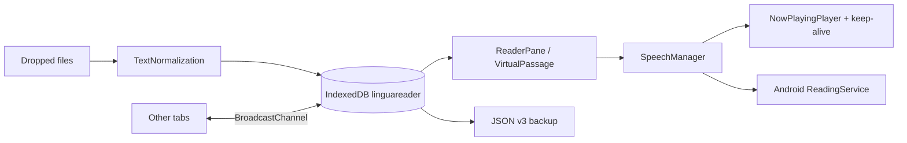
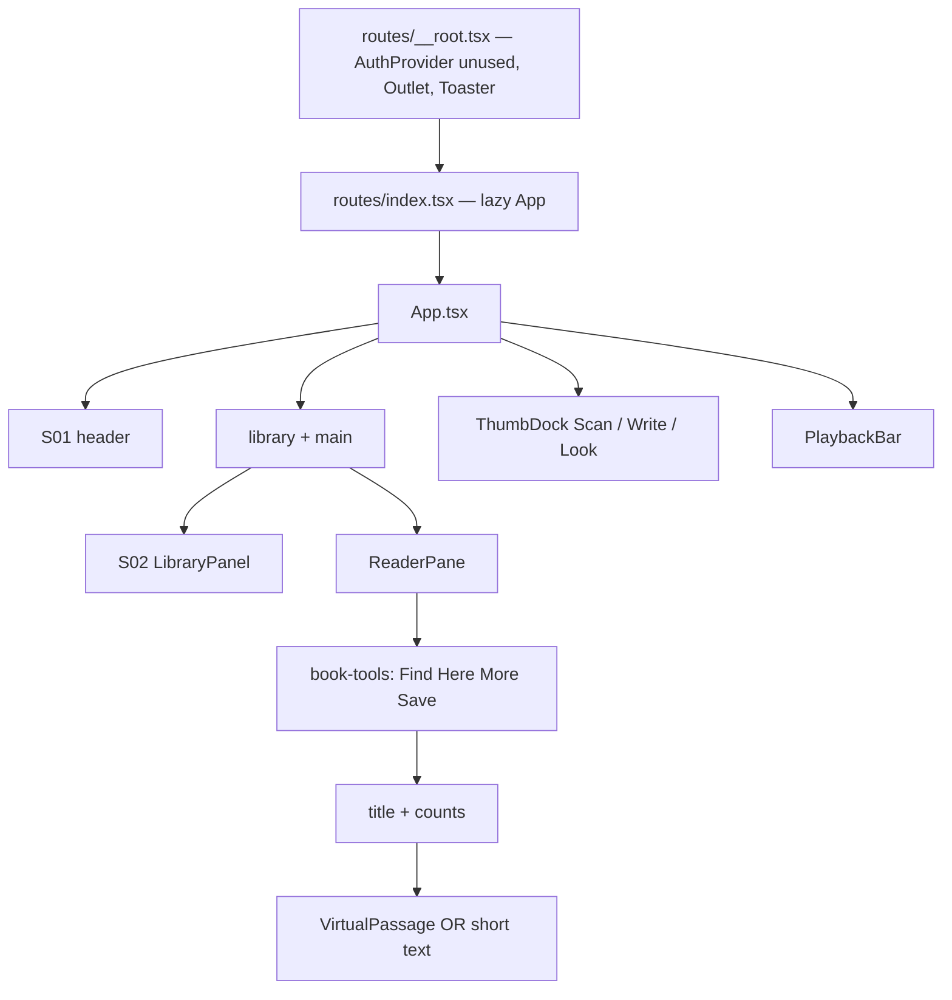

# LinguaReader Application Knowledge Base

**App:** LinguaReader  
**AKB version:** 1.5.82  
**Date:** 2026-10-18  
**applicationId:** `com.linguareader.app` (immutable)  
**IndexedDB:** `linguareader` (immutable identity)

This document is the operational memory of LinguaReader. Update it on every instruction. Do not rewrite past Change Log rows.

---

## Difference vs previous AKB (1.5.80)

| Area | 1.5.80 | 1.5.82 |
|---|---|---|
| Phone book tools | Save book could sit off the edge. | The tool row wraps, so Save book stays on the screen. |
| Windows Chrome | Library and book, with the player along the bottom, and pen and palette floating on the page. | Three columns: library, book, and a player column on the right. No bottom bar. No floating pen and palette. |
| Phones | Bottom player and floating buttons | Unchanged. A finger screen does not get the Windows columns. |
| Resume, sorting, sticky title, Book loading, voices | Working | Unchanged. |
| Version | 1.5.80 / 10580 | **1.5.82 / 10582** |

---

## Difference vs previous AKB (1.5.79)

| Area | 1.5.79 | 1.5.80 |
|---|---|---|
| Top bar | An Android app button sat in the header. | That button is gone. Install stays on a computer. |
| Continue / Start of book | The page stayed as it was, with the tools open. | Chrome hides, the player options close, and the saved line sits at the top. After that, scrolling and Auto-Follow work as before. |
| Library, sticky title, Book loading, voices | Working | Unchanged. |
| Version | 1.5.79 / 10579 | **1.5.80 / 10580** |

---

## Difference vs previous AKB (1.5.78)

| Area | 1.5.78 | 1.5.79 |
|---|---|---|
| Last Read | Used the time the file was last saved, so the book being read did not rise. | Uses the same clock as the startup resume prompt: `linguareader.resume.v1` and the progress `updatedAt`. Unread books stay at the bottom. |
| Opening a book | Did not update that clock. | Opening or playing writes the resume time without moving the reading place. |
| Other sorts, buttons, sticky title, loading, player | Working | Unchanged. |
| Version | 1.5.78 / 10578 | **1.5.79 / 10579** |

---

## Difference vs previous AKB (1.5.77)

| Area | 1.5.77 | 1.5.78 |
|---|---|---|
| Library buttons | Add, Android app, and Backup | Add and Backup only. They share the row. Android app stays in the top bar. |
| Sort cycle | Recent, A–Z, Read % | Recent, A–Z, Read %, Last Read. Last Read is the last time the book was opened, not a progress save. |
| Sticky title, Book loading, player | Working | Still there. |
| Version | 1.5.77 / 10577 | **1.5.78 / 10578** |

---

## Difference vs previous AKB (1.5.76)

| Area | 1.5.76 | 1.5.77 |
|---|---|---|
| Library order | Newest activity first, with no way to change it. | A Sort button next to Search cycles Recent, A–Z, and Read %. The choice is remembered on this phone. |
| Open chapters and place | Unchanged | Sorting does not close the open book or move the reading place. |
| Sticky title and Book loading | Working | Still there. |
| Version | 1.5.76 / 10576 | **1.5.77 / 10577** |

---

## Difference vs previous AKB (1.5.75)

| Area | 1.5.75 | 1.5.76 |
|---|---|---|
| Library | The book list could show plain bullets and lose its row layout. | The list is a clean flex column again, with pill buttons and no bullets, on the phone and on Windows. |
| Book loading | The message sat in the page flow. | It is a separate full-screen layer on top of everything, and it is not inside the book list. |
| Sticky title | Phone only | Still there. |
| Version | 1.5.75 / 10575 | **1.5.76 / 10576** |

---

## Difference vs previous AKB (1.5.74)

| Area | 1.5.74 | 1.5.75 |
|---|---|---|
| Adding a book | A large file froze the screen with no message, so it looked broken. | “Book loading” covers the screen before the file is read, then goes away when the book opens or if the file fails. |
| Windows Chrome layout | Sticky titles stay off | Still off. The overlay only appears while a book is being added. |
| Speech and the player | Working | Not touched. |
| Version | 1.5.74 / 10574 | **1.5.75 / 10575** |

---

## Difference vs previous AKB (1.5.73)

| Area | 1.5.73 | 1.5.74 |
|---|---|---|
| Phone library | Opening chapters scrolls the book title off the top, so the book is hard to close. | On a phone, the open book’s title stays under Search. Only the chapter list moves, underneath that title. |
| Windows Chrome | Unchanged | Still unchanged. This layout is phone-only. |
| Speech and the player | Working | Not touched. The player stays pinned at the bottom. |
| Version | 1.5.73 / 10573 | **1.5.74 / 10574** |

---

## Difference vs previous AKB (1.5.70)

| Area | 1.5.70 | 1.5.73 |
|---|---|---|
| Android Chrome voice list | Get Mandarin opened the Play Store even when the voice app was already installed. Mandarin was easy to miss. | Get Mandarin is gone. Mandarin and the other Chinese voices stay in the System list. |
| Lock-screen Stop, Android Chrome | Pressing Stop on the lock screen could start reading again a second later. | Stop stays stopped. The phone’s extra Play is ignored. |
| Lock-screen Stop, iPhone Chrome | The same Stop tap was treated as a gap between sentences when the next line was already waiting, so reading continued. | Stop cuts the voice and stays quiet. Android Chrome is not changed by this fix. |
| Version | 1.5.70 / 10570 | **1.5.73 / 10573** |

---

## Difference vs previous AKB (1.5.69)

| Area | 1.5.69 | 1.5.70 |
|---|---|---|
| Android Chrome Mandarin | A failed storyteller fetch stopped, and Cantonese was not used. No Mandarin phone voice was listed. | Chrome lists the phone’s Simplified Chinese voices as Mandarin. Get Mandarin opens Google’s own voice download so Chinese (China) can be installed. Cantonese is still not used as a stand-in. |
| Version | 1.5.69 / 10569 | **1.5.70 / 10570** |

## Difference vs previous AKB (1.5.66)

| Area | 1.5.66 | 1.5.69 |
|---|---|---|
| 林华, 沈言, Clara, Rowan | Microsoft closed the old voice address on 12 Oct 2026. Every platform showed “Could not fetch that voice.” | The app now asks the new voice address. The four storytellers can be fetched again. |
| Android Chrome phone voice | When the fetch failed, the phone spoke with its Cantonese female voice. | Android Chrome has no Simplified Chinese voice of its own. The app no longer substitutes Cantonese. It stops and says so. |
| Chapter list and Here | Later 1.5.67 and 1.5.68 fixes: the last chapters scroll, the highlight walks down the page, and Here is a one-time jump. | Kept. |
| Version | 1.5.66 / 10566 | **1.5.69 / 10569** |

## Difference vs previous AKB (1.5.65)

| Area | 1.5.65 | 1.5.66 |
|---|---|---|
| Heart and the other English offline voices | The engine file was opened the wrong way, so play stopped at once | The engine is handed over as raw sound data, one thread, no code import |
| Version | 1.5.65 / 10565 | **1.5.66 / 10566** |

## Difference vs previous AKB (1.5.64)

| Area | 1.5.64 | 1.5.65 |
|---|---|---|
| Heart | Preview blocked the English engine file | The engine file is loaded as sound data, not as app code |
| Yue | Too quiet to use for a story | Raised to normal speaking loudness and steadied the tone |
| Version | 1.5.64 / 10564 | **1.5.65 / 10565** |

## Difference vs previous AKB (1.5.63)

| Area | 1.5.63 | 1.5.64 |
|---|---|---|
| Yue | Play failed: the voice file was missing two required pieces | Those pieces are now sent, so Yue can speak |
| Heart | Play failed: the English engine file did not match the voice program | The matching engine file now ships inside the app |
| Version | 1.5.63 / 10563 | **1.5.64 / 10564** |

## Difference vs previous AKB (1.5.62)

| Area | 1.5.62 | 1.5.63 |
|---|---|---|
| Chinese offline | Not available. 林华 and 沈言 still needed the internet for a new line | One Mandarin voice, Yue, can be saved on the phone and then read Chinese with no internet |
| What it is not | — | Yue is not 林华. This pack has no male voice, so 沈言 is unchanged |
| English offline | Heart, Bella, Michael, Emma, Fable | Unchanged |
| Version | 1.5.62 / 10562 | **1.5.63 / 10563** |

## Difference vs previous AKB (1.5.60)

| Area | 1.5.60 | 1.5.62 |
|---|---|---|
| Offline storyteller | A saved phone voice reads with the phone's own speaker | A downloadable English voice pack (Heart, Bella, Michael, Emma, Fable) can be saved on the phone and then read English with no internet |
| Chinese | 林华 and 沈言 unchanged | Still unchanged. This pack cannot speak Mandarin, Cantonese, or Hokkien |
| Loudness | Player boost only | The saved English voice is made louder before playback so it sits closer to a phone voice |
| Grok voice file | — | Not possible. Grok speaks on the internet. It does not provide a file the phone can keep and use for any book |
| Version | 1.5.60 / 10560 | **1.5.62 / 10562** |

## Difference vs previous AKB (1.5.59)

| Area | 1.5.59 | 1.5.60 |
|---|---|---|
| Saved voice | An uploaded file played as one recording | Record or upload a voice onto the phone. A recorded voice reads the open book offline with the phone voice you choose |
| Internet | Storytellers still fetch new lines | The saved voice does not use the internet. Storytellers are unchanged |
| Honest limit | — | The recording is kept on the phone. It is not turned into a new storyteller voice |
| Version | 1.5.59 / 10559 | **1.5.60 / 10560** |

## Difference vs previous AKB (1.5.58)

| Area | 1.5.58 | 1.5.59 |
|---|---|---|
| Stop on iPhone Chrome and Android Chrome | One tap stopped the storyteller, then it started again after 1–2 seconds | One tap stays stopped. The next line already being fetched is dropped |
| Other platforms | Unchanged | Android app, Windows Chrome, and iPhone Safari are unchanged |
| Version | 1.5.58 / 10558 | **1.5.59 / 10559** |

## Difference vs previous AKB (1.5.57)

| Area | 1.5.57 | 1.5.58 |
|---|---|---|
| New backup downloads | `linguareader-all.json` and the three older names | `lr-<type>_<env>_<id>_<yymmdd-hhmm>.json` |
| Save all | one fixed name | `ful` |
| Library of books | one fixed name | `jrn` |
| Settings / storyteller voices | one fixed name | `set` / `voc` |
| Old backup files | Still open | Still open. Restore reads the file contents, not the name |
| Reading | Unchanged | Unchanged |
| Version | 1.5.57 / 10557 | **1.5.58 / 10558** |

## Difference vs previous AKB (1.5.56)

| Area | 1.5.56 | 1.5.57 |
|---|---|---|
| Governance | Informal AKB only | LR-AKB-GOS is adopted as the operating rulebook |
| False claims in the pasted rulebook | Would have been treated as already built | Corrected. Notes, a separate language library, and Zustand are not in this app |
| Android signing | Key alias `linguareader` | Unchanged. The suggested alias `lr` is rejected so updates keep installing |
| Reading behavior | 1.5.56 | Unchanged |
| Version | 1.5.56 / 10556 | **1.5.57 / 10557** |

## Difference vs previous AKB (1.5.55)

| Area | 1.5.55 | 1.5.56 |
|---|---|---|
| Pause | Extra player options stayed closed | Pause opens them again. Play still closes them |
| Windows Chrome | The whole app sat in a narrow column on a wide screen | At 1280px and wider the window is used edge to edge: library on the left, a wide reading page, and a full-width player. Smaller windows keep the previous layout |
| Phone and APK screens | Unchanged layout | Unchanged layout. Pause behavior matches |
| Version | 1.5.55 / 10555 | **1.5.56 / 10556** |

## Difference vs previous AKB (1.5.54)

| Area | 1.5.54 | 1.5.55 |
|---|---|---|
| Save & restore | Three separate saves | Save all writes settings, books, and storyteller voices into one file |
| Player options | Could stay open after Play | Play closes the extra options |
| APK storytellers | A failed next line showed “Could not fetch that voice” and stopped | The app retries that line and keeps reading |
| Version | 1.5.54 / 10554 | **1.5.55 / 10555** |

## Difference vs previous AKB (1.5.53)

| Area | 1.5.53 | 1.5.54 |
|---|---|---|
| APK storyteller loudness | 林华, 沈言, Clara, and Rowan were quieter than phone voices | The installed app boosts those four voices to about the same loudness as the phone voices |
| Other platforms | Unchanged | Unchanged |
| Version | 1.5.53 / 10553 | **1.5.54 / 10554** |

## Difference vs previous AKB (1.5.52)

| Area | 1.5.52 | 1.5.53 |
|---|---|---|
| APK phone voice gender | Female names were treated as male, so the labels were swapped | US male, Chinese female, Chinese male, Cantonese female, and Cantonese male use the matching voice |
| Get voices | The download screen often did not open | Opens the phone’s text-to-speech settings, where the missing voice can be installed |
| Other platforms | Unchanged | Unchanged |
| Version | 1.5.52 / 10552 | **1.5.53 / 10553** |

## Difference vs previous AKB (1.5.51)

| Area | 1.5.51 | 1.5.52 |
|---|---|---|
| Android APK storytellers | Web download failed with “Could not fetch that voice” | The installed app downloads 林华, 沈言, Clara, and Rowan itself |
| Android APK phone voices | Not listed | Phone voices group lists UK and US English, Chinese, and Cantonese when the phone has them. Get voices opens the phone’s voice download |
| Other platforms | Unchanged | Unchanged |
| Version | 1.5.51 / 10551 | **1.5.52 / 10552** |

## Difference vs previous AKB (1.5.50)

| Area | 1.5.50 | 1.5.51 |
|---|---|---|
| Android APK storytellers | The four voices did not download | The installed app now collects the voice audio itself, so 林华, 沈言, Clara, and Rowan can be fetched and saved |
| Android APK phone voices | Not listed | UK and US English, male and female; Chinese male and female; Cantonese female, when the phone has them |
| iPhone and Android Chrome | Unchanged | Unchanged |
| Version | 1.5.50 / 10550 | **1.5.51 / 10551** |

## Difference vs previous AKB (1.5.49)

| Area | 1.5.49 | 1.5.50 |
|---|---|---|
| Android Chrome Cantonese | Still silent | Removed from the voice list. A saved choice of that voice returns to the storyteller. Android Chrome voice work stops here |
| iPhone Chrome | Unchanged | Unchanged. Sinji stays on iPhone |
| Version | 1.5.49 / 10549 | **1.5.50 / 10550** |

## Difference vs previous AKB (1.5.48)

| Area | 1.5.48 | 1.5.49 |
|---|---|---|
| Android Chrome Cantonese | Still silent, highlight moved on | Last attempt: free the speaker, start Cantonese inside the tap, and try the phone’s Cantonese language instead of the silent Samsung voice object |
| iPhone Chrome | Unchanged | Unchanged |
| Version | 1.5.48 / 10548 | **1.5.49 / 10549** |

## Difference vs previous AKB (1.5.47)

| Area | 1.5.47 | 1.5.48 |
|---|---|---|
| Android Chrome Cantonese | The phone voice moved the highlight with no speech | The voice is now asked to speak as Cantonese (zh-HK / yue-HK) instead of a tag Android Chrome drops |
| iPhone Chrome | Unchanged | Unchanged |
| Version | 1.5.47 / 10547 | **1.5.48 / 10548** |

## Difference vs previous AKB (1.5.46)

| Area | 1.5.46 | 1.5.47 |
|---|---|---|
| Android Chrome Cantonese | The phone’s Cantonese voice skipped ahead while a low hum played | The hum is stopped, and that voice is given time to speak instead of skipping |
| Player options | Stayed open for a moment after play | Close as soon as play starts |
| iPhone Chrome | Unchanged | Unchanged |
| Version | 1.5.46 / 10546 | **1.5.47 / 10547** |

## Difference vs previous AKB (1.5.45)

| Area | 1.5.45 | 1.5.46 |
|---|---|---|
| Android Chrome storytellers | The four storytellers were quieter than the phone’s own voices | Android Chrome only: 林华, 沈言, Clara, and Rowan are louder, matched to the phone voices. iPhone Chrome is unchanged |
| Android Chrome phone voices | No female Cantonese voice in the list | A female Cantonese phone voice is listed when the phone has one |
| Version | 1.5.45 / 10545 | **1.5.46 / 10546** |

## Difference vs previous AKB (1.5.44)

| Area | 1.5.44 | 1.5.45 |
|---|---|---|
| Phone voices | Still the later 1.5.36 reader | Restored to the 1.5.33 phone-voice list and handoff. The storyteller engine is closed before a phone voice is used |
| Storytellers | Unchanged | Unchanged |
| Version | 1.5.44 / 10544 | **1.5.45 / 10545** |

## Difference vs previous AKB (1.5.43)

| Area | 1.5.43 | 1.5.44 |
|---|---|---|
| Phone voices | Later experiments left Tingting and Sinji silent | Phone voices are restored to the 1.5.36 reader. No background or lock-screen attempt for those voices |
| Storytellers | Unchanged | Unchanged. 林华, 沈言, Clara, and Rowan stay as they are |
| Version | 1.5.43 / 10543 | **1.5.44 / 10544** |

## Difference vs previous AKB (1.5.42)

| Area | 1.5.42 | 1.5.43 |
|---|---|---|
| Phone voices | Play went through a delayed path, so the iPhone dropped Tingting and Sinji | Play now starts the phone voice immediately in the tap itself |
| Version | 1.5.42 / 10542 | **1.5.43 / 10543** |

## Difference vs previous AKB (1.5.41)

| Area | 1.5.41 | 1.5.42 |
|---|---|---|
| Phone voices | Tingting and Sinji stayed silent when the iPhone ringer was off, while the storytellers still played | Phone voices now use the same loudspeaker route as the storytellers, with no extra hum |
| Version | 1.5.41 / 10541 | **1.5.42 / 10542** |

## Difference vs previous AKB (1.5.40)

| Area | 1.5.40 | 1.5.41 |
|---|---|---|
| Phone voices | Tingting and Sinji made no sound. The play tap was still changing the phone’s audio route and cancelling speech | Play now speaks straight away with the phone’s own voice. Nothing else is allowed to cancel that speech |
| Version | 1.5.40 / 10540 | **1.5.41 / 10541** |

## Difference vs previous AKB (1.5.39)

| Area | 1.5.39 | 1.5.40 |
|---|---|---|
| Phone voices | A low background tone was all that could be heard; Tingting and Sinji were covered | That tone is turned off. Phone voices speak on their own again |
| Version | 1.5.39 / 10539 | **1.5.40 / 10540** |

## Difference vs previous AKB (1.5.38)

| Area | 1.5.38 | 1.5.39 |
|---|---|---|
| Phone voices in the background | The iPhone stopped them on the lock screen because nothing was registered as playing media | Phone voices now keep a real audio hold, the same idea as YouTube, so the lock screen and app switch can keep them going |
| Version | 1.5.38 / 10538 | **1.5.39 / 10539** |

## Difference vs previous AKB (1.5.37)

| Area | 1.5.37 | 1.5.38 |
|---|---|---|
| Phone voices | A quiet background tone cut Tingting and Sinji off after one word and kept them in the earpiece | That tone no longer plays while a phone voice is reading. The phone is asked to use the loudspeaker, the same route as the four storytellers |
| Version | 1.5.37 / 10537 | **1.5.38 / 10538** |

## Difference vs previous AKB (1.5.36)

| Area | 1.5.36 | 1.5.37 |
|---|---|---|
| Phone voices | Tingting, Daniel, Samantha, and the other phone voices stopped when the screen locked or Chrome was switched away | Those voices now keep a quiet audio hold, the same kind the four storytellers use, so reading continues on the lock screen and in the background |
| Version | 1.5.36 / 10536 | **1.5.37 / 10537** |

## Difference vs previous AKB (1.5.35)

| Area | 1.5.35 | 1.5.36 |
|---|---|---|
| Clara and Rowan | The iPhone paused itself in the gap after a paragraph, so reading stopped | That automatic pause is ignored, and the next sentence starts |
| Version | 1.5.35 / 10535 | **1.5.36 / 10536** |

## Difference vs previous AKB (1.5.34)

| Area | 1.5.34 | 1.5.35 |
|---|---|---|
| Clara and Rowan | A paragraph could end and reading stopped | The end of a paragraph now starts the next sentence |
| Other languages | Removing extra English voices also removed every other language | Other languages are back. English phone voices remain only Daniel and Samantha |
| Version | 1.5.34 / 10534 | **1.5.35 / 10535** |

## Difference vs previous AKB (1.5.33)

| Area | 1.5.33 | 1.5.34 |
|---|---|---|
| Storyteller loudness | 林华, 沈言, Clara, and Rowan were quieter than the phone voices | Those four are boosted to about the same loudness as the phone voices |
| English phone voices | Every English phone voice was listed | Only Daniel (English) and Samantha (English) remain |
| Daniel and Samantha | A Chinese page swapped them for another voice, and the menu could fall back to Storyteller | The chosen phone voice is kept, including while switching from the menu |
| Clara and Rowan | A paragraph could repeat while the highlight moved on | A clip is not treated as finished until most of it has played |
| Version | 1.5.33 / 10533 | **1.5.34 / 10534** |

## Difference vs previous AKB (1.5.32)

| Area | 1.5.32 | 1.5.33 |
|---|---|---|
| 沈言 | The highlight moved on, but the iPhone kept playing the previous paragraph | The old clip is stopped before the next one is loaded, and a repeated clip is not played again |
| 林华, Tingting, Meijia | Working | Left as they are |
| Version | 1.5.32 / 10532 | **1.5.33 / 10533** |

## Difference vs previous AKB (1.5.31)

| Area | 1.5.31 | 1.5.32 |
|---|---|---|
| Tingting | Waited a long time after a sentence, and the storyteller could take over as 林华 | The next sentence starts when she finishes. The storyteller no longer starts while a phone voice is selected |
| Phone voices | Meijia was listed as Chinese, and Sinji was not marked as Cantonese | The list is Tingting (Chinese) and Sinji (Cantonese). A Hokkien woman is shown only if the phone has one |
| Version | 1.5.31 / 10531 | **1.5.32 / 10532** |

## Difference vs previous AKB (1.5.30)

| Area | 1.5.30 | 1.5.31 |
|---|---|---|
| Tingting speed | Spoken at normal speed even when the slider said 1.3× | The speed slider applies to the phone voice again |
| Voice list | Tingting, Meijia, and Sinji were each listed twice | Each phone voice is listed once. The iPhone still has no built-in male Chinese voice; 沈言 remains the male Chinese reader |
| Version | 1.5.30 / 10530 | **1.5.31 / 10531** |

## Difference vs previous AKB (1.5.29)

| Area | 1.5.29 | 1.5.30 |
|---|---|---|
| Tingting | The storyteller speaker was turned on in the same tap, and the next line was started over her, so only “王” was heard | Play no longer turns on the storyteller speaker. She is left on the sentence until it has had time to finish |
| 林华 and 沈言 | Unchanged | Unchanged |
| Other platforms | Unchanged | Android and Windows are unchanged |
| Version | 1.5.29 / 10529 | **1.5.30 / 10530** |

## Difference vs previous AKB (1.5.28)

| Area | 1.5.28 | 1.5.29 |
|---|---|---|
| Tingting | Still stopped after the first two words when the speed slider was above normal | iPhone's own voice now speaks the whole sentence at normal speed. Faster speeds were making the phone cut her off |
| 林华 and 沈言 | Follow the speed slider | Still follow the speed slider |
| Other platforms | Unchanged | Android and Windows are unchanged |
| Version | 1.5.28 / 10528 | **1.5.29 / 10529** |

## Difference vs previous AKB (1.5.27)

| Area | 1.5.27 | 1.5.28 |
|---|---|---|
| Tingting | Several lines were started together, so iPhone Chrome cut her off after about two words | She is given one sentence, and the next sentence starts only after that one finishes |
| 林华 and 沈言 | Switching works | Left as it is |
| Other platforms | Unchanged | Android and Windows phone-voice playback is unchanged |
| Version | 1.5.27 / 10527 | **1.5.28 / 10528** |

## Difference vs previous AKB (1.5.26)

| Area | 1.5.26 | 1.5.27 |
|---|---|---|
| Switching 林华 and 沈言 | The old voice kept reading the sentence it had already fetched | Choosing a voice stops the old one immediately and starts the new one from the same sentence |
| Tingting | A second start cancelled the first, so the phone voice died at once | On iPhone, several sentences are lined up in the same tap, so the phone voice is not restarted and cut off |
| Other platforms | Unchanged player | Android and Windows still use their existing player. Only the iPhone handoff changed |
| Version | 1.5.26 / 10526 | **1.5.27 / 10527** |

## Difference vs previous AKB (1.5.25)

| Area | 1.5.25 | 1.5.26 |
|---|---|---|
| 林华 and 沈言 | Each new sentence waited on the network, and the player kept saying Fetching | The next sentences are fetched together and saved on the phone. The same sentence plays at once the next time. iPhone also takes whichever copy of the voice arrives first |
| Tingting | Play stopped the phone voice at once | The storyteller speaker is turned off before a phone voice starts, so Tingting can keep talking |
| Other platforms | Storyteller fetch order unchanged | The next sentences are prepared ahead on every platform. The iPhone-only race and the phone-voice speaker handoff do not run on Android or Windows |
| Version | 1.5.25 / 10525 | **1.5.26 / 10526** |

## Difference vs previous AKB (1.5.24)

| Area | 1.5.24 on iPhone Chrome | 1.5.25 |
|---|---|---|
| 林华, 沈言, Clara, Rowan | Pause came on and the sentence highlighted, but no voice was heard | On iPhone only, those voices play through the phone’s own sound engine, the same one a song uses |
| Phone voices such as Tingting | A short sound, then silence in under a second | On iPhone only, the phone voice is allowed to finish the sentence and continue. The one-second cutoff is removed |
| Other platforms | Unchanged | **Unchanged** |
| Version | 1.5.24 / 10524 | **1.5.25 / 10525** |

## Difference vs previous AKB (1.5.23)

| Area | 1.5.22 on iPhone Chrome | 1.5.24 |
|---|---|---|
| Play | The pause button came on, but no voice was heard for 林华, 沈言, Clara, Rowan, or a phone voice | On iPhone only, Play no longer resets the speaker before the voice starts, and a phone voice is no longer cleared in the same instant it should speak |
| Other platforms | Unchanged | **Unchanged** |
| Version | App 1.5.22 | **1.5.24 / 10524** |

## Difference vs previous AKB (1.5.22)

| Area | 1.5.22 | 1.5.23 |
|---|---|---|
| Rulebook | Fixes were written one phone at a time | Master Prompt v5 is now the permanent rulebook. Reading stays on the device. One shared speech plan for all four platforms |
| The app the user opens | 1.5.22 player | **Unchanged.** No new install is required for this step |
| Version | 1.5.22 / 10522 | Knowledge base **1.5.23**. App build stays **1.5.22 / 10522** until the next behavior change |

## Governance

Permanent prompt: `LINGUAREADER-MASTER-PROMPT-v5.md`.

Order of work from here:

1. Keep Play working on Android Chrome, the Android app, iPhone Chrome, and Windows Chrome.
2. Fold phone-specific speech patches into one shared reader, without a big-bang rewrite.
3. Then offline voice packs, speed, and accessibility checks.

A release is not called finished unless those four platforms still pass.

## Difference vs previous AKB (1.5.21)

| Area | 1.5.21 | 1.5.22 |
|---|---|---|
| iOS Chrome | 林华 and 沈言 could stay silent after Play. A failed follow-up clip made the player think it was already talking | On iPhone only, Play starts the storyteller clip again if the phone did not begin, and a later clip problem no longer mutes the voice that is already going |
| Android and desktop | Unchanged | **Unchanged** |
| Version | 1.5.21 / 10521 | **1.5.22 / 10522** |

## Difference vs previous AKB (1.5.20)

| Area | 1.5.20 | 1.5.21 |
|---|---|---|
| iOS Chrome | A pause was inserted between paragraphs, so the phone closed the audio | On iPhone only, the next paragraph starts immediately, the way a music track continues. The phone voice also waits until the current piece has actually finished, then continues |
| Android and desktop | Unchanged | **Unchanged** |
| Version | 1.5.20 / 10520 | **1.5.21 / 10521** |

## Difference vs previous AKB (1.5.19)

| Area | 1.5.19 | 1.5.20 |
|---|---|---|
| iOS Chrome | The next paragraph was started in the same instant the previous one ended, so iPhone Chrome dropped the sound | On iPhone only, the next piece waits a fraction of a second and is spoken again if the phone ignored it |
| Android and desktop | Unchanged | **Unchanged** |
| Version | 1.5.19 / 10519 | **1.5.20 / 10520** |

## Difference vs previous AKB (1.5.18)

| Area | 1.5.18 | 1.5.19 |
|---|---|---|
| iOS Chrome | A long sentence could stop the phone voice after a few seconds, and changing voice waited on the old queue | On iPhone only, each spoken piece stays under 100 characters, and picking a new voice clears the queue and continues the same sentence at once |
| Android and desktop | Unchanged | **Unchanged** |
| Version | 1.5.18 / 10518 | **1.5.19 / 10519** |

## Difference vs previous AKB (1.5.17)

| Area | 1.5.17 | 1.5.18 |
|---|---|---|
| iOS Chrome and Android Chrome | The stall warning could still be attached to the player | Those browsers never attach the stall warning. They use the same player path as desktop Chrome |
| Installed Android app | Stall check used the Capacitor flag alone | The stall check also requires the Android app bridge, so a phone browser cannot match it |
| Version | 1.5.17 / 10517 | **1.5.18 / 10518** |

## Difference vs previous AKB (1.5.16)

| Area | 1.5.16 | 1.5.17 |
|---|---|---|
| Android Chrome | A stall timer could stop reading and say “Playback stalled” even while the voice was fine | Android Chrome uses the normal website player again. That warning is no longer raised there |
| Installed Android app | Storyteller workaround could also match a loose phone check | The workaround runs only when the app is the real installed Android app |
| Version | 1.5.16 / 10516 | **1.5.17 / 10517** |

## Difference vs previous AKB (1.5.15)

| Area | 1.5.15 | 1.5.16 |
|---|---|---|
| Android voice | A failed fetch could sit on “Fetching the selected voice…” and play a low muffled tone | The Android app waits at most 8 seconds. If the clip is empty or not real speech, it stops that tone and reads with the phone’s own voice |
| Website and iPhone | Unchanged | **Unchanged** |
| Version | 1.5.15 / 10515 | **1.5.16 / 10516** |

## Difference vs previous AKB (1.5.14)

| Area | 1.5.14 | 1.5.15 |
|---|---|---|
| Android app voices | The installed Android app often failed to fetch 林华, 沈言, Clara, and Rowan | Only the Android app file sends those requests to the real voice address, waits longer, and saves a successful clip on the phone |
| Website and iPhone | Unchanged | **Unchanged** |
| Version | 1.5.14 / 10514 | **1.5.15 / 10515** |

## Difference vs previous AKB (1.5.13)

| Area | 1.5.13 | 1.5.14 |
|---|---|---|
| System voice | One long speech request. If the phone never said it finished, pause and the next sentence were ignored | Speech is split into short pieces. If a piece never finishes, it is dropped and the next one starts. Three stalls in a row stop playback so the buttons work again |
| Custom voice | A saved clip could sit in “playing” forever if the file never ended | The clip is watched. If it never starts, or the sound stops moving, playback stops and the screen is usable again |
| Switching voices | A storyteller clip could keep running under a phone voice, so pause hit the wrong player | Leaving a storyteller voice stops that player before the phone voice or a saved clip starts |
| Version | 1.5.13 / 10513 | **1.5.14 / 10514** |

## Difference vs previous AKB (1.5.12)

| Area | 1.5.12 | 1.5.13 |
|---|---|---|
| Chapter list | Full list, no “you are here” mark | The chapter that matches the current sentence is marked **Here** and stays in view |
| Jump | Tap a title, then the library closed | Tap a title, reading moves there, and the **Here** mark follows |
| Version | 1.5.12 / 10512 | **1.5.13 / 10513** |

## Difference vs previous AKB (1.5.10)

| Area | 1.5.10 | 1.5.12 |
|---|---|---|
| Chapters | Fifteen titles at a time, then a Load more button | Every chapter for that book is in one list. Scroll from the first title to the last |
| Jump | Tap a shown chapter | Tap any chapter. Reading starts at that sentence |
| Version | 1.5.10 / 10510 | **1.5.12 / 10512** |

## Difference vs previous AKB (1.5.9)

| Area | 1.5.9 | 1.5.10 |
|---|---|---|
| Wallpaper | Painted on the hidden page behind a solid paper panel, and only after the save finished | Linen, Moss, Dusk, Ink wash, Plain paper, and My photo paint the reading page the moment you tap |
| Custom photo | Waited for the file to be stored, and used a lock-screen style that iPhone often hides | The photo shows at once. A light paper veil keeps the words readable |
| Version | 1.5.9 / 10509 | **1.5.10 / 10510** |

## Difference vs previous AKB (1.5.8)

| Area | 1.5.8 | 1.5.9 |
|---|---|---|
| Roles and mixes | Player had Roles and Mix | Removed on every phone and computer |
| Chapters | None | Each book lists chapters, 15 at a time |
| Voice change | Could ask about a saved mix | The new voice starts at the same sentence immediately |
| Backup | Settings, books, mixes | Settings, books with chapters, storyteller audio clips |
| Version | 1.5.8 / 10508 | **1.5.9 / 10509** |

## Previous difference (1.5.6)

| Area | 1.5.6 | 1.5.8 |
|---|---|---|
| iOS play | Silent keep-alive loop ran on every phone | iOS WebKit unlocks AudioContext on the Play tap and skips the Blink silent loop |
| Android Chrome | Silent keep-alive + speech pulse | **Unchanged** |
| AI helper | None | Optional free key saved only on this device (`aiProvider`, `aiApiKey`, `aiSelectedModel`) |
| Release folder | `dist-apk/client` | `dist-release/LinguaReader-v1.5.22/` |
| Version | 1.5.6 / 10506 | **1.5.8 / 10508** |

---

## System Overview

LinguaReader is a **local-first text-to-speech reader** for Chinese and English novels. It runs as:

- a **Progressive Web App** (Chrome, Safari, Firefox, Edge; iOS Chrome and Android Chrome)
- an **Android APK** (Capacitor WebView + foreground reading service)
- an **iOS Capacitor shell** (background audio keys in Info.plist)

Nothing essential lives in the cloud. Books, progress, voices, mixes, and look-and-feel stay on the device in IndexedDB. Optional online pieces (neural storyteller clips) cache locally after first fetch.

**Who it is for:** a non-technical reader who wants to listen to `.txt` / `.epub` / `.docx` novels (including GB18030 Chinese files) with lock-screen controls, bookmarks, and role-mix voices.

**Non-goals:** accounts, social feed, cloud library, ads, unused Auth/DB scaffolds.



---

## Module Register

| ID | Module | Path | Responsibility |
|---|---|---|---|
| M01 | App shell | `src/App.tsx` | Library load, file ingest, player wiring, chrome hide, auto-follow |
| M02 | Router | `src/router.tsx`, `src/routes/` | Single-page `/` via TanStack Start |
| M03 | Storage | `src/services/StorageService.ts` | IndexedDB, backups v1–v3, settings surfaces |
| M04 | Sync | `src/services/SyncService.ts` | BroadcastChannel across tabs |
| M05 | Speech | `src/services/SpeechManager.ts` | Sentence queue, roles, neural/custom/system TTS |
| M06 | Now playing | `src/services/media/NowPlayingPlayer.ts` | Clip timing, MediaSession, hold pad |
| M07 | Keep-alive | `src/services/media/SessionKeepAlive.ts` | Silent Web Audio so browsers keep playing |
| M08 | Native reading | `src/services/media/NativeReading.ts` + Android Java | Foreground service on APK |
| M09 | Storyteller | `src/services/media/storyteller.ts` | 林华 / 沈言 / Clara / Rowan |
| M10 | Import | `src/services/FileImport.ts` + `documents/` | txt, md, json, epub, docx, pdf, rtf, html |
| M11 | Encoding | `src/utils/textNormalization.ts` | UTF-8/16 BOM, GB18030, GBK |
| M12 | Sentences | `src/utils/sentences.ts` | Paragraph-aware split |
| M13 | Cast | `src/utils/cast.ts` | Role detection + SavedCast |
| M14 | Appearance | `src/lib/appearance.ts` | Theme, font, wallpaper, focus chrome |
| M15 | PWA | `vite.config.ts` + `src/lib/pwa.ts` | Manifest, service worker |
| M16 | Capacitor | `capacitor.config.ts`, `android/`, `ios/` | Native wrappers |
| M18 | Platform | `src/utils/platform.ts` | `isIOS()` / `isAndroid()` only |
| M19 | AI config | `src/components/reader/AIConfigDialog.tsx` | Local free-key form |

---

## Screen Register

LinguaReader is one route (`/`). Screens are **overlays and regions** on that page.

| ID | Screen | Trigger | Primary components |
|---|---|---|---|
| S01 | Reader Home | App open | Header, ReaderPane, PlaybackBar, ThumbDock |
| S02 | Library | Library / Close | LibraryPanel |
| S03 | Look & reach | Palette | AppearanceSheet |
| S04 | Save & restore | Backup | BackupSheet |
| S05 | Resume prompt | Reopen with progress | ResumeDialog |
| S06 | Role mix picker | Roles on | MixPackPickerDialog |
| S07 | Mix choice | Voice change with mix | MixChoiceDialog |
| S08 | Cast editor | Mix | CastDialog |
| S09 | Custom voice | Mic | VoiceDialog |
| S10 | Find | Find | FindBar |
| S11 | Scan | Camera thumb | ScanSheet |
| S12 | Handwrite | Pen thumb | HandwriteSheet |
| S13 | Rename | Title / rename | RenameDialog |
| S14 | Get Android | Android / phone icon | GetAndroidDialog |
| S15 | Confirm delete | Bin | ConfirmDialog |
| S16 | Install PWA | Install button | InstallButton |
| S17 | Free AI helper | Library → Backup → Free AI helper | AIConfigDialog |

---

## Feature Register

| ID | Feature | Default | Notes |
|---|---|---|---|
| F01 | Open txt/md/json/epub/docx/pdf/rtf/html | on | Encoding auto + GB18030 override |
| F02 | IndexedDB library | on | Offline |
| F03 | Last-read resume prompt | on | Skip or jump |
| F04 | Autosave offset | on | On sentence advance + pause/stop |
| F05 | TTS play/pause/skip/stop | on | MediaSession lock screen |
| F06 | Storyteller voices | on | 林华 沈言 Clara Rowan |
| F07 | Role mix | off | Saved as mix packs, not in settings backup only |
| F08 | Custom uploaded voice | opt | Stored as blobs |
| F09 | Auto-Follow Highlight | **on** | Off = never snap; On = pause on scroll, resume next paragraph after 2.5s idle |
| F10 | Show/Hide Chrome | **off** (show) | Session only; reload always shows chrome |
| F11 | Here | — | One-shot jump to current line |
| F12 | Background / lock-screen audio | on | Keep-alive + Android foreground service |
| F13 | Cross-tab sync | on | BroadcastChannel, no network |
| F14 | Typed backups | on | Settings / Library / Mix packs |
| F15 | Full backup JSON v3 | on | SHA-256 digest |
| F16 | PWA install | on | Web only |
| F17 | Android APK download | Android Chrome | `/downloads/LinguaReader.apk` |
| F18 | Night mode, fonts, wallpaper | on | Visual store per desktop/mobile |
| F19 | Scan / handwrite gloss | opt | Camera / canvas |
| F20 | Rename book | on | Display title only |
| F21 | iOS play unlock | iOS only | AudioContext resumed inside the Play tap |
| F22 | Free AI helper key | off | Saved in settingsDesktop / settingsMobile. Not required to read. |

---

## Invariants / Business Rules

These must not be broken.

1. **`applicationId` stays `com.linguareader.app`.** Never rename the Android id. The Android signing key alias stays `linguareader`.
2. **IndexedDB name stays `linguareader`.** Do not migrate identity.
3. **No required cloud account.** Auth/DB scaffolds stay unused.
4. **Reading position is local.** Swiping the app away must restore the last sentence on that book.
5. **Auto-Follow Highlight Off** never recenters the passage, including iOS Chrome scroll-up.
6. **Show/Hide Chrome** defaults to Show on every reload. Hidden mode is session-only so users cannot get stuck.
7. **Backup JSON v3** always writes `settingsDesktop` and `settingsMobile`.
8. **v1 and v2 backups still import.** Digest math for v2 stays the old canonical payload.
9. **Mix packs** are a separate backup kind from settings and library.
10. **Sample books** may refresh text but must keep the user’s sentence offset.
11. **Neural storyteller** may use the network; playback must still work with system TTS offline.
12. **APK versionName** must match `APP_VERSION`; **versionCode** must increase on every APK.
13. **Android Chrome keep-alive** (silent pad + oscillator) must stay on. iOS must not use that loop.
14. **AI keys** are optional and local. Reading works with `aiProvider: "none"`.

There is **no RNG and no coin table** in this product. Those compliance lines from other apps do not apply, except: do not invent them.

---

## Persistence

### Stores (IndexedDB `linguareader`, schema 11)

| Store | Key | Contents |
|---|---|---|
| documents | `id` | Title, rawText, encoding, offsets, optional sourceBytes |
| meta | `key` | settings, settingsDesktop, settingsMobile, wallpaper, backups, seed |
| progress | `documentId` | sentenceOffset, title, updatedAt |
| voices | `id` | Custom voice blobs |
| ttsCache | `id` | Neural clips |
| casts | `documentId` | SavedCast / BookCast |
| mixPresets | `id` | Role mix packs per narrator |

Also: `localStorage` key `linguareader.resume.v1` for crash-safe resume.

### Visual surfaces

| Surface | Meta key | Chosen when |
|---|---|---|
| desktop | `settingsDesktop` | Pointer is fine, not iOS/Android UA |
| mobile | `settingsMobile` | iOS, Android, or coarse + narrow |
| mirror | `settings` | Last written surface (legacy readers) |

Look (theme, type, wallpaper, control size, hand) can differ per surface. Playback voice/rate and the optional AI key still save on the active surface (`settingsDesktop` or `settingsMobile`).

AI fields inside each settings block: `aiProvider` (`google` | `groq` | `grok` | `none`), `aiApiKey`, `aiSelectedModel`. Default is off.

### Backup JSON v3 (full)

```json
{
  "app": "LinguaReader",
  "version": 3,
  "kind": "linguareader.full-backup",
  "exportedAt": 0,
  "documents": [],
  "settings": {},
  "settingsDesktop": {},
  "settingsMobile": {},
  "progress": [],
  "resume": null,
  "casts": [],
  "voiceBank": [],
  "voices": [],
  "wallpaper": null,
  "digest": "sha256-hex"
}
```

Typed files:

- `linguareader.settings` v3 — settings + settingsDesktop + settingsMobile + wallpaper
- `linguareader.library` — books + progress + resume
- `linguareader.mix-pack` — role mix presets + four storytellers

### SavedCast schema

```ts
interface BookCast {
  documentId: string;
  language: "zh" | "en";
  roles: CastRole[];
  updatedAt: number;
  narratorURI?: string | null; // new
  packId?: string | null;      // new
  surface?: "desktop" | "mobile"; // new
}
```

---

## Integrations

| Integration | Required? | Notes |
|---|---|---|
| Browser `speechSynthesis` | Fallback | System voices |
| Web Audio + HTMLAudioElement | Yes for lock-screen | Keep-alive + clip playback |
| Media Session API | Yes | Lock-screen play/pause/skip |
| BroadcastChannel | Yes | Multi-tab |
| IndexedDB | Yes | Library |
| Capacitor Android | APK | `ReadingService` foreground, `FOREGROUND_SERVICE_MEDIA_PLAYBACK` |
| Capacitor iOS | iOS app | `UIBackgroundModes = audio` |
| Neural TTS (`story-tts`) | Optional online | Cached in `ttsCache` |
| Vite PWA / Workbox | Web | Offline shell |
| Vercel / GitHub Pages | Hosting only | Static files |
| Auth / Postgres | **Off** | Do not enable |

---

## Impact Matrix

| Change | M01 App | M03 Storage | M05 Speech | S01 Reader | S02 Library | S04 Backup | APK |
|---|---|---|---|---|---|---|---|
| Encoding / import | • | • | | • | • | | |
| Resume / autosave | • | • | • | • | | | |
| Auto-follow | • | • | | • | | | |
| Chrome hide | • | | | • | | | |
| Role mix | • | • | • | | | • | |
| Backup v3 | | • | | | | • | |
| Background audio | | | • | | | | • |
| Visual surface split | • | • | | • | | • | |
| Sticky book title (phone) | | | | | • | | |

---

## Troubleshooting

| Symptom | Likely cause | Fix |
|---|---|---|
| Mojibake on Chinese txt | Wrong encoding | Use GB18030 / GBK control, keep sourceBytes |
| Play stops ~1s or at lock | Browser suspended TTS | Keep-alive + MediaSession; APK uses foreground service |
| Repeats last sentence | Queue cleared / index rewind | Do not `cancel()` the whole queue on pause; persist offset |
| Reads half a sentence | Utterance timeout too short | Native timeout vs web; do not skip on keep-alive ticks |
| No 林华 / only 沈言 | Clip fetch / iOS vs Chrome cache | Storyteller cache; Mix off uses selected voice |
| Highlights ≠ audio | Follow vs virtual window | Auto-Follow off must not `scrollIntoView` the window |
| iOS Chrome snap-back | Page scroll + prepend jump | Book pane is the only scroller; restore prepend by anchor |
| APK blank / shows 1.2.0 | Stale or unsigned web assets | Rebuild, validate versionName, uninstall old APK |
| Fetching voice forever | Neural hang on WebView | 5s native timeout, fall back to one neural |
| Close button under home bar | Sheet not using safe-area | Dialog sheet + svh + sticky X |
| iOS Chrome silent or blocked on Play | WebKit autoplay | Play tap must create and resume AudioContext before speech |
| Android Chrome stopped after an iOS fix | Keep-alive removed for everyone | Silent loop must stay on when `isIOS()` is false |

---

## AI Maintenance

When Grok (or another agent) receives a new instruction:

1. Read this AKB and `docs/AKB-PROTOCOL.md`.
2. Classify: bug, feature, persist, native, or packaging.
3. Touch only listed modules. Do not enable Auth/DB. Do not change `applicationId`.
4. Bump version if behavior or a binary changes.
5. Append a Change Log row.
6. Refresh AKB `.md` + `.docx`, APK, and source ZIP to the **same** version.
7. Write the difference table at the top of the new AKB.

Use the templates below for the Change Log description.

---


## Governance (LR-AKB-GOS)

Adopted 2026-09-25 as the operating rulebook. The AKB remains the source of truth for what the app actually does. If the rulebook and this AKB disagree, this AKB wins until a later version changes the product on purpose.

### Accepted

- Every change maps to a rule, a screen, a test note, and a release.
- Do not break reading, file opening, the saved place, or backup restore.
- Desktop and mobile look-and-feel stay in separate stores.
- Backup JSON v3 must keep `settingsDesktop` and `settingsMobile`.
- AKB `.md`, AKB `.docx`, the Android APK, and the source ZIP ship at the same version.
- Auth and unused database scaffolds stay off.
- `applicationId` stays `com.linguareader.app`.

### Rejected (would break the working app)

| Pasted rule | Decision | Why |
|---|---|---|
| Sign the APK with key alias `lr` | Keep alias `linguareader` | A new key makes Android refuse the update |
| Put the APK only in `dist-apk/client` | Also keep `public/downloads/LinguaReader.apk` and `dist-release/` | The in-app download button uses the public file |
| Rename backups to `lr-ful_...json` | Done in 1.5.58 for new downloads. Old files still restore | Yesterday’s files open because restore ignores the file name |
| Build an iPhone install file this release | Deferred | You asked to skip the installed iPhone app |
| Treat notes, Zustand, and a language-parser library as already tested | Not in the product | Playback highlight is not a notebook. There is no Zustand store |

### Corrected requirement map

| ID | Real status in 1.5.57 |
|---|---|
| F01 Reading and opening files | In the app. Not a separate `reader-engine.test.ts` |
| F02 Notes and annotations | Not built. Do not claim it is stable |
| F03 Save and resume | In the app. IndexedDB `linguareader` |
| F04 Backup and restore | In the app. JSON only, not CSV |
| F05 Several languages in one book | In the app, inside the reader, not a separate parser product |
| F06 Fonts, night mode, wallpaper | In the app |
| F07 Read aloud | In the app. The microphone is not recorded |
| F08 Desktop and mobile settings | In the app. They do not overwrite each other |
| F09 Find in the open book | In the app. It does not search notes |
| F10 Same version on AKB, APK, and ZIP | This release |

The named files `annotation.test.ts`, `parser.test.ts`, and the rest of that pasted test list do not exist. They must not be cited as proof.

## Change Log

Append-only.

| Version | Date | Changes | Modules | Screens | Cross-engine | Tests |
|---|---|---|---|---|---|---|
| 1.5.82 | 2026-10-18 | Phone book tools wrap so Save book stays visible. Windows Chrome (mouse, 1024px and wider) uses three columns and hides the bottom player and the floating pen and palette. Phones keep the bottom player. | App, Reader, Player | S01 Reader | Windows desktop vs phones | On a phone, confirm Save book is tappable and the player is at the bottom. On Windows, confirm library, book, and a right-hand player, with no bottom bar. |
| 1.5.80 | 2026-10-18 | Resume Continue and Start of book hide chrome, collapse player options, and pin the saved line to the top once. The Android app button is gone from the header. Later scrolling still follows Auto-Follow. | App, Reader, Player | S01 Reader | All five | Open a book partway, choose Continue. Header and extra player options are gone. The saved line is at the top. Scroll, then play, and Auto-Follow behaves as before. |
| 1.5.79 | 2026-10-18 | Fixed Last Read. It now follows the resume snapshot and progress.updatedAt. Books with no progress stay at the bottom. An empty library does not crash. | Storage | S02 Library | All five | Read one book, switch to Last Read, and confirm it is first. A never-opened book stays below it. |
| 1.5.78 | 2026-10-18 | Removed the Android app button from the library row. Sort now includes Last Read, saved as linguareader.sortMode lastRead, using lastOpenedAt. Opening a book does not move the reading place. | Library, Storage | S02 Library | All five | Confirm only Add and Backup. Cycle to Last Read, open another book, and confirm it rises. |
| 1.5.77 | 2026-10-18 | Library Sort next to Search cycles Recent, A–Z, and Read %. The choice is saved in localStorage as linguareader.sortMode. Sorting does not close chapters or move the reading place. Sticky title and Book loading stay. | Library, Storage | S02 Library | All five | Cycle the three labels. Reload and confirm the same order. Open chapters, then sort, and confirm they stay open. |
| 1.5.76 | 2026-10-18 | Emergency library layout restore. Book rows are a flex list with no bullets and pill buttons again. “Book loading” is a separate full-screen layer, not part of the list. The phone sticky title remains. | Library, App | S02 Library | All five | Open the library on a phone and on Windows. Rows should not be bullets. Add a book and confirm the loading words sit on top. |
| 1.5.75 | 2026-10-18 | Adding a book shows “Book loading” before the file is parsed. The message covers the library and the player, then clears on success or a bad file. Speech, audio, and Android native files were not changed. | App, import | S01 Reader, S02 Library | All five | Add a large text file. The words appear before the wait. A bad file removes the message. |
| 1.5.74 | 2026-10-17 | On a phone, an open book’s title stays under Search while its chapters scroll underneath. Collapsed books scroll normally. Windows Chrome is unchanged. Speech and the player were not touched. | Library | S02 Library | Phone only | Open a long chapter list on a phone. The title stays. Collapse it and the list scrolls as before. Windows Chrome does not pin the title |
| 1.5.73 | 2026-10-16 | iOS Chrome lock-screen Stop now stays stopped. A queued next line no longer swallows the tap, and the phone is not allowed to press Play again by itself. Android Chrome is unchanged. | Speech, NowPlaying | S01 Reader | iOS Chrome | Play 林华 on iPhone Chrome, lock the phone, tap stop. It must stay quiet. Android Chrome still stops |
| 1.5.72 | 2026-10-12 | Lock-screen Stop stays stopped. The phone was sending Play again a moment later. Voice fetching is unchanged. | Speech, NowPlaying | S01 Reader | iOS Chrome, Android Chrome | Play 林华, lock the phone, press stop. It must stay quiet |
| 1.5.71 | 2026-10-12 | Android Chrome: removed Get Mandarin. It opened the Play Store for a voice app that was already installed. Mandarin and the other Chinese voices now stay in the System voice list, where the user can select them. | PlaybackBar | S01 Reader | Android Chrome | Open the voice list on Android Chrome. Chinese China is under System. There is no Get Mandarin button |
| 1.5.70 | 2026-10-12 | Android Chrome lists Mandarin system voices and links Get Mandarin to Google Text-to-speech so Chinese (China) can be downloaded. Cantonese is not used in place of Simplified Chinese. | Speech, PlaybackBar | S01 Reader | Android Chrome | Open the voice list. Tap Get Mandarin. Download Chinese (China). Choose Mandarin and press play |
| 1.5.69 | 2026-10-12 | Storyteller fetch uses the new Microsoft address after the old one began returning 403. Android Chrome no longer falls back to Cantonese, because that phone has no Simplified Chinese voice. | Storyteller, Speech, PlaybackBar, PhoneVoice | S01 Reader | All | Play 林华 on Android Chrome, iPhone Chrome, and Windows Chrome. Confirm it does not switch to Cantonese if the fetch fails |
| 1.5.66 | 2026-10-01 | English offline voices load the ONNX engine as a raw wasm binary instead of a code import. | Kokoro | S01 Reader | Windows Chrome | Play Heart, Bella, Michael, Emma, and Fable on an English page |
| 1.5.65 | 2026-10-01 | Heart loads its engine through a blob so the preview no longer rejects the file. Yue is peak-normalized to speaking loudness. | Kokoro, Chinese offline | S01 Reader | Windows Chrome | Play Heart on English and Yue on Chinese |
| 1.5.64 | 2026-10-01 | Fix Yue missing prosody and speaker inputs. Fix Heart by shipping the matching ONNX engine file instead of a mismatched download. | Chinese offline, Kokoro, Speech | S01 Reader | Windows Chrome first, then the others | Play Yue on a Chinese page and Heart on an English page |
| 1.5.63 | 2026-10-01 | Save one female Mandarin voice on the phone. After that, Chinese reading with Yue needs no internet. It is not 林华. 沈言 stays online. | Chinese offline engine, Speech, Playback | S01 Reader | All | Save Chinese voice, airplane mode, read a Chinese page with Yue |
| 1.5.62 | 2026-10-01 | Offline English voice pack. One download, then Heart, Bella, Michael, Emma, and Fable read English with no internet. Chinese books stay on 林华 and 沈言. | Kokoro engine, Speech, Playback | S01 Reader | All | Save offline voices, turn on airplane mode, read an English page |
| 1.5.60 | 2026-09-30 | Save a voice on this phone. Record a short sample, pick a phone voice, and Play reads the book offline. Uploaded files that are only recordings still play as recordings. | Voice dialog, Speech, Storage | S01 Reader | All | Record a voice, turn on airplane mode, press Play |
| 1.5.59 | 2026-09-28 | iPhone Chrome and Android Chrome: stopping a storyteller no longer starts again by itself a second later. | Speech, NowPlaying | S01 Reader | iOS Chrome, Android Chrome | Play 林华, tap pause once, wait 3 seconds. It must stay quiet. Tap play and it continues |
| 1.5.58 | 2026-09-26 | New backup downloads use `lr-<type>_<env>_<id>_<yymmdd-hhmm>.json`. Save all is `ful`, the library is `jrn`, settings are `set`, voices are `voc`. Older backup files still restore. | Backup names, App | Save & restore | All | Save all on Windows Chrome and confirm the name. Restore a 1.5.56 file |
| 1.5.57 | 2026-09-25 | Adopted LR-AKB-GOS. Rejected a new signing key, backup rename, and claims about notes that the app does not have. Reading behavior unchanged. | AKB, app-info | none | All | Confirm the title shows v1.5.57 and a 1.5.56 book still opens |
| 1.5.56 | 2026-09-25 | Pause expands player options. Wide Windows layout uses the full window and still shrinks cleanly. | PlaybackBar, App, ReaderPane | S01 Reader, S02 Library | Android APK, Windows Chrome | Pause and play. Resize Chrome from 1920 down |
| 1.5.55 | 2026-09-25 | Save all backup. Play collapses player options. APK storyteller retries a failed line instead of stopping. | BackupSheet, PlaybackBar, SpeechManager | S01 Reader | Android APK | Install 1.5.55. Play a storyteller through several sentences. Save all. |
| 1.5.54 | 2026-09-25 | Raised APK storyteller playback loudness for 林华, 沈言, Clara, and Rowan. Other platforms unchanged. | NowPlayingPlayer | S01 Reader | Android APK | Install 1.5.54. Compare a storyteller with a phone voice |
| 1.5.53 | 2026-09-25 | Corrected APK male/female voice matching, including Cantonese male and female. Get voices opens text-to-speech settings. | AndroidVoices, PhoneVoice | S01 Reader | Android APK | Install 1.5.53. Check US male, Chinese female/male, Cantonese female/male |
| 1.5.52 | 2026-09-25 | APK fetches storytellers natively and lists the phone’s UK, US, Chinese, and Cantonese voices. Get voices opens the system download. Other platforms unchanged. | PhoneVoice, Storyteller, PlaybackBar | S01 Reader | Android APK | Install 1.5.52. Play 林华. Open the voice list |
| 1.5.51 | 2026-09-25 | Android APK storyteller download fixed. APK phone list adds UK/US English male and female, Chinese male and female, and Cantonese female. Other platforms unchanged. | Storyteller, PlaybackBar | S01 Reader | Android WebView | Install 1.5.51 APK. Play 林华. Check Phone voices |
| 1.5.50 | 2026-09-25 | Removed the silent Android Chrome Cantonese phone voice from the list and dropped its special speech path. iPhone unchanged. | Speech, PlaybackBar | S01 Reader | Blink | Refresh to v1.5.50. Confirm Cantonese Hong Kong is gone from Phone voices |
| 1.5.49 | 2026-09-25 | Last Android Chrome attempt for the female Cantonese phone voice: release storyteller audio, speak during the tap, try yue-HK then zh-HK. iPhone unchanged. | Speech, NowPlaying | S01 Reader | Blink | Refresh to v1.5.49. Select Cantonese Hong Kong and tap play |
| 1.5.48 | 2026-09-25 | Android Chrome Cantonese Hong Kong phone voice uses a language tag Chrome can speak, and a silent instant finish no longer skips the paragraph. iPhone unchanged. | Speech | S01 Reader | Blink | Refresh to v1.5.48. Select Cantonese Hong Kong and tap play |
| 1.5.47 | 2026-09-25 | Android Chrome Cantonese phone voice no longer hums and skips. Player options close when play starts. iPhone unchanged. | Speech, PlaybackBar | S01 Reader | Blink | Refresh to v1.5.47. Play the Cantonese phone voice and confirm the options close on play |
| 1.5.46 | 2026-09-24 | Android Chrome: louder storytellers and a female Cantonese phone voice. iPhone Chrome unchanged. | NowPlaying, PlaybackBar | S01 Reader | Blink | Refresh to v1.5.46 on Android Chrome. Compare a storyteller with a phone voice, and check Cantonese under Phone voices |
| 1.5.45 | 2026-09-24 | Phone voices restored to the 1.5.33 reader and voice list. Storytellers unchanged. | Speech, PlaybackBar | S01 Reader | WebKit | Refresh to v1.5.45. Choose Tingting or Sinji and tap play with the screen on |
| 1.5.44 | 2026-09-24 | Restored phone voices to the 1.5.36 path. Background playback is not attempted for those voices. Storytellers unchanged. | Speech, App | S01 Reader | WebKit | Refresh to v1.5.44. Play Tingting and Sinji in the foreground |
| 1.5.43 | 2026-09-24 | Phone voices start speaking inside the play tap, with a fresh voice from the phone. | Speech, App | S01 Reader | WebKit | Refresh to v1.5.43. Play Tingting and Sinji |
| 1.5.42 | 2026-09-24 | Phone voices use the loudspeaker route so the silent switch no longer mutes them. No background hum. | Speech | S01 Reader | WebKit | Refresh to v1.5.42. Play Tingting and Sinji |
| 1.5.41 | 2026-09-24 | Phone voices speak directly again. Audio-route changes and lock-screen pause no longer cancel them. | Speech | S01 Reader | WebKit | Refresh to v1.5.41. Play Tingting and Sinji and confirm spoken words |
| 1.5.40 | 2026-09-24 | Removed the background tone that was covering Tingting and Sinji. | Speech | S01 Reader | WebKit | Refresh to v1.5.40. Play Tingting and Sinji and confirm the voice, not a hum |
| 1.5.39 | 2026-09-24 | Phone voices keep a media hold for lock screen and background, and restart a line if the phone cuts the first word. | Speech, SessionKeepAlive | S01 Reader | WebKit | Refresh to v1.5.39. Play Tingting, lock the phone, and switch away from Chrome |
| 1.5.38 | 2026-09-24 | Phone voices speak full lines again and are routed to the loudspeaker. The background tone starts only after the screen locks. | Speech | S01 Reader | WebKit | Refresh to v1.5.38. Play Tingting and Sinji in the open, then lock the phone |
| 1.5.37 | 2026-09-24 | Phone voices stay active on the lock screen and when leaving Chrome, using the same media hold as the storytellers. | Speech, SessionKeepAlive | S01 Reader | WebKit, Blink | Refresh to v1.5.37. Play Tingting or Daniel, lock the phone, and switch away from Chrome. Reading should continue |
| 1.5.36 | 2026-09-24 | iPhone no longer treats the gap after a Clara or Rowan paragraph as a user pause. The next sentence starts on its own. | NowPlaying, Speech | S01 Reader | WebKit media session | Refresh to v1.5.36. Play Clara through several paragraphs and confirm the highlight keeps moving |
| 1.5.35 | 2026-09-24 | iPhone storyteller clips advance to the next sentence when a paragraph ends. Non-English phone voices are listed again. | NowPlaying, Speech, PlaybackBar | S01 Reader | WebKit | Refresh to v1.5.35. Play Clara through several sentences. Open the voice list and confirm other languages are present, with only Daniel and Samantha under English |
| 1.5.34 | 2026-09-24 | Storyteller playback is louder. English phone list is Daniel and Samantha only, and those voices stay selected. iPhone clips wait until the paragraph has played before moving on. | Speech, NowPlaying, PlaybackBar | S01 Reader | WebKit | Refresh to v1.5.34. Compare 林华 loudness with Tingting. Play Clara and Rowan across paragraphs. Switch to Daniel and Samantha while reading |
| 1.5.33 | 2026-09-24 | iPhone storyteller clips stop before the next paragraph is decoded. A clip identical to the previous one is rejected instead of replayed. Highlight moves only after the new clip starts. | NowPlaying | S01 Reader | WebKit storyteller | Refresh to v1.5.33. Play 沈言 across several paragraphs and confirm the spoken text matches the highlight |
| 1.5.32 | 2026-09-24 | iPhone phone-voice playback advances on the real end of the sentence. Storyteller playback cannot start over Tingting. Phone list is language-bracketed. | Speech, PlaybackBar | S01 Reader | WebKit system voice | Refresh to v1.5.32. Play Tingting through two sentences at 1.3×. Confirm the voice menu shows Tingting (Chinese) and Sinji (Cantonese) once each |
| 1.5.31 | 2026-09-24 | Phone voices follow the speed slider. Duplicate system voices are collapsed by name. | Speech, PlaybackBar | S01 Reader | Shared list, iPhone speed path | Refresh to v1.5.31. Confirm one Tingting, one Meijia, one Sinji. Play Tingting at 1.3× |
| 1.5.30 | 2026-09-24 | iPhone system voices no longer share the tap with the storyteller audio engine. A too-early end signal no longer starts the next sentence over the current one. | Speech, App, NowPlaying | S01 Reader | WebKit system voice only | Refresh to v1.5.30. Choose Tingting, tap Play once, and let the highlighted sentence finish |
| 1.5.29 | 2026-09-24 | iPhone system voices such as Tingting speak at normal speed so the phone no longer cuts them off after the first words. Storyteller voices still use the speed slider. The storyteller audio engine is no longer shut down in the same moment Tingting starts. | Speech, NowPlaying | S01 Reader | WebKit system voice only | Refresh to v1.5.29. Choose Tingting at 1.3x and press Play. She should read the whole sentence. Then play 林华 and confirm the slider still speeds her up |
| 1.5.28 | 2026-09-24 | iPhone system voices such as Tingting now speak one sentence at a time. Starting several sentences together was cutting her off after the first couple of words. Storyteller switching is unchanged. | Speech | S01 Reader | WebKit system voice only | Refresh to v1.5.28. Choose Tingting and press Play. She should read the whole highlighted sentence, then the next |
| 1.5.27 | 2026-09-24 | iPhone voice switch now cuts the clip that is already playing, clears the waiting sentences, and starts the newly chosen storyteller from the current sentence. Phone voices such as Tingting are queued in one tap instead of being restarted, which had silenced them. | Speech, NowPlaying | S01 Reader | WebKit only | Refresh to v1.5.27. While 沈言 is speaking, choose 林华. The label and the voice should change without waiting out the old sentence. Then play Tingting and confirm it continues |
| 1.5.26 | 2026-09-24 | Storyteller sentences are fetched ahead and stored in the on-device voice cache, so a repeated sentence does not wait on the network. iPhone starts from the first copy that arrives. Phone voices such as Tingting no longer lose the speaker to the storyteller engine. | Speech, Storyteller, NowPlaying | S01 Reader | WebKit handoff is iPhone-only. Prefetch is shared | Refresh to v1.5.26. Play 林华 past the first sentence. Pause, go back, play the same sentence and confirm it starts without a long fetch. Then play Tingting and confirm it keeps speaking |
| 1.5.25 | 2026-09-24 | iOS Chrome: storyteller voices were silent because the speaker element never started. They now play through the unlocked phone audio engine. Phone voices such as Tingting were cut off in under a second by a speaking-flag check; that check is removed so the sentence can finish and the next one can follow. Android Chrome, Android APK, and Windows Chrome playback paths are unchanged. | Speech, NowPlaying | S01 Reader | WebKit only | Refresh to v1.5.25. Play 林华 through a few sentences. Then play Tingting and confirm it does not die in the first second |
| 1.5.24 | 2026-09-24 | iOS Chrome was showing Pause with no sound. Removed the iPhone audio reload that dropped the Play tap, and stopped clearing the phone voice in the same instant it starts. Android Chrome, Android APK, and Windows Chrome playback paths are unchanged. | Speech, NowPlaying | S01 Reader | WebKit only | Refresh until the title shows v1.5.24. Press Play on 林华, then on a phone voice. Sound must be heard |
| 1.5.23 | 2026-09-24 | Adopted Master Prompt v5 as the permanent rulebook: offline-first, no accounts, one shared speech plan, four-platform checks before a release. No playback code changed. App binary remains 1.5.22 / 10522. | Docs | None | No engine change | Confirm 林华 still plays on iPhone Chrome 1.5.22 before any speech rewrite |
| 1.5.22 | 2026-09-24 | iOS only: storyteller playback no longer stays silent when the phone delays or rejects the first play. The clip is loaded and started with a short retry. A failed later clip does not cancel a voice that is already audible. Android APK, Android Chrome, and desktop Chrome keep the previous play path. | Speech, NowPlaying | S01 Reader | WebKit only | On iOS Chrome, press Play with 林华 and with 沈言. Voice must be heard. Confirm Android Chrome is unchanged |
| 1.5.21 | 2026-09-24 | iOS only: removed the gap before the next audio clip and restored immediate media handoff. Storyteller clips are prepared further ahead. If a clip is late, iPhone retries it instead of dropping into a silent stop. Phone-voice pieces advance when speaking actually ends, without cancelling the voice engine. Android APK, Android Chrome, and desktop Chrome are unchanged. | Speech, NowPlaying | S01 Reader | WebKit only | On iOS Chrome, play several paragraphs with 林华 and with a phone voice. Sound must continue with no abrupt stop. Confirm Android Chrome still behaves as before |
| 1.5.20 | 2026-09-24 | iOS only: chained speech no longer cancels the voice engine inside the end event, and the next paragraph starts after a short gap with one retry if the phone stayed silent. Media clips on iPhone also start the next paragraph outside the end event. Android and desktop keep the old timing. | Speech, NowPlaying | S01 Reader | WebKit only | On iOS Chrome, play through at least two paragraphs with a phone voice and with 林华. Sound must continue. Confirm Android Chrome is unchanged |
| 1.5.19 | 2026-09-24 | iOS only: system speech is cut into pieces shorter than 100 characters, and a voice change cancels the WebKit queue then speaks the current sentence immediately. Android APK, Android Chrome, and desktop Chrome keep the previous chunk sizes and the 40ms speak delay. | Speech | S01 Reader | WebKit only. Blink paths unchanged | On iOS Chrome, play a long sentence with a phone voice, then switch voices while it is speaking. Confirm it continues at once and does not stop after a few seconds |
| 1.5.18 | 2026-09-24 | Playback stalled is registered and armed only inside the Android APK. iOS Chrome and Android Chrome ignore stall and waiting watchdogs and keep the desktop web playback path. isAndroidAPK requires both the Capacitor native flag and the Android bridge. | platform, NowPlaying, Speech | S01 Reader | WebKit and Blink browsers stay on the web path. APK keeps the stall guard | Play for several minutes in iOS Chrome and Android Chrome. The stall sentence must not appear. APK still falls back if a storyteller clip never arrives |
| 1.5.17 | 2026-09-24 | isAndroidAPK() is true only when Capacitor reports a native Android shell. Android Chrome no longer hits the storyteller URL rewrite or the 15s stall stop. The stall warning stays inside the APK only. | platform, storyteller, NowPlaying | S01 Reader | Android Chrome uses the web path. APK stays on the native voice path | Play 林华 in Android Chrome for several minutes. Confirm it does not stop with Playback stalled. Install the APK and confirm it still falls back to the phone voice if the storyteller clip does not arrive |
| 1.5.16 | 2026-09-24 | Android APK only: storyteller requests use the absolute voice address, accept only a real speech file, and give up after 8 seconds. Empty or muffled clips are not played or saved. Playback then uses the phone voice. Web and iOS paths are unchanged. | storyteller | S01 Reader | Capacitor Android WebView only | Install the APK, pick 林华 with no network, confirm the phone voice starts within 8 seconds and the low tone stops |
| 1.5.15 | 2026-09-24 | Android APK only: storyteller fetches use an absolute voice address instead of the app’s local page address, ignore a false offline flag, wait up to 18s, try the backup neural names, and cache the clip. Web and iOS fetch paths are unchanged. INTERNET permission remains. | storyteller, AndroidManifest | S01 Reader | Capacitor Android WebView only | Install the APK, pick 林华, play a sentence, then play the same sentence with the network off |
| 1.5.14 | 2026-09-24 | System and custom voices no longer lock the player when speech never finishes. Short speech pieces, a stall timer, and a hard stop after repeated stalls. Pause, stop, and chapter jumps clear every player. Storyteller audio is stopped before a phone voice or saved clip starts. | Speech, NowPlaying | S01 Reader | WebKit and Blink share the same stall guard. No speechSynthesis pause/resume keepalive. | Pick a phone voice, play, pause, and skip. Pick a saved clip. Switch from 林华 to a phone voice while playing |
| 1.5.13 | 2026-09-24 | Open chapter lists still show every chapter. The chapter matching the current sentence is highlighted and labeled Here, and the list scrolls that row into view. Tapping a chapter jumps there and moves the highlight. | Library, App | S02 Library | Same mark on WebKit and Blink. Scroll stays inside the chapter list. | Open chapters mid-book and confirm Here; tap a later chapter and confirm the mark moves |
| 1.5.12 | 2026-09-24 | Chapter lists no longer stop at 15. Opening chapters shows the full list in one scroll. Tapping a title still jumps to that sentence. | Library | S02 Library | Same drawer on WebKit and Blink | Open a long novel, scroll to the last chapter, tap it |
| 1.5.10 | 2026-09-23 | Wallpaper modes apply on the reading page immediately, including a custom photo. No reload. Same behavior on iOS, Android, and desktop. | Appearance, App shell, styles | S03 Look | WebKit and Blink: background is on the visible page, not behind it. No background-attachment:fixed. | Tap each wallpaper with the sheet open and confirm the page behind changes before Done |
| 1.5.9 | 2026-09-23 | Removed roles, mixes, and character casting on every platform. Chapter list under each book, 15 at a time. Voice dropdown hot-swaps without a prompt. Backups include chapter marks and the local storyteller clip cache. Offline missing clips fall back to the phone voice. | Speech, Storage, Library, Playback | S01, S02, S04 | WebKit and Blink share the same player path | Open a numbered Chinese novel, jump to chapter 16; switch 林华 to 沈言 while playing; restore a voice backup offline |
| 1.5.8 | 2026-09-23 | iOS Play unlocks WebKit AudioContext inside the tap. iOS skips the Blink silent keep-alive loop. Android Chrome path unchanged. Free AI helper key saved locally in both visual stores. Release folder `dist-release/LinguaReader-v1.5.8/`. | M05, M07, M18, M19, M03 | S02, S17, S01 | WebKit: AudioContext on Play, no silent loop. Blink: keep-alive unchanged. | Play on iOS Chrome starts voice; Android Chrome still plays past lock; AI off still reads; APK 1.5.8 / 10508 |
| 1.5.6 | 2026-09-20 | Baseline AKB (md+docx). Backup JSON **v3** with `settingsDesktop` + `settingsMobile`. SavedCast gains `narratorURI`, `packId`, `surface`. APK copied to `dist-apk/client`. Source ZIP. | M03, M13, M16 | S04 | Both | Import v1, v2, v3 backups; desktop vs mobile settings do not overwrite each other; APK versionName 1.5.6 / versionCode 10506 |
| 1.5.5 | 2026-09-20 | iOS Chrome scroll-up no longer snaps to highlight. Book pane is the only scroller. No `scrollIntoView` on the window. Prepend keeps an anchor line. | M01, reader VirtualPassage | S01 | iOS Chrome Auto-Follow **off**, scroll up/down while paused and playing |
| 1.5.4 | 2026-09-20 | Auto-Follow Highlight toggle. Default on. Manual scroll suspends immediately. Resume only on next paragraph after 2.5s idle. Here is one-shot. | M01, PlaybackBar, ReaderPane | S01 | Toggle off never snaps; toggle on idle follow |
| 1.5.3 | 2026-09-20 | Show/Hide Chrome on the player. Default Show. Session-only. Reload always shows chrome. | M01, PlaybackBar | S01 | Reload cannot stay hidden |
| 1.5.2 | 2026-09-20 | Keep-alive + Android foreground reading; hide chrome while playing (later reversed to session toggle) | M05–M08 | S01 | Lock screen > 2:30 |
| 1.2.0–1.5.1 | 2026-09 | Encoding, mix packs, backups, APK packaging, PWA, Capacitor | many | many | Historical product path |

---

## Templates

### New Feature

```
Goal:
Screen(s):
Module(s):
Default on/off:
Persistence (desktop / mobile / neither):
Backup impact (v3 fields):
Tests:
AKB sections to update: Feature Register, Screen Register, Impact Matrix, Change Log
```

### Bug

```
Symptom:
Platform (iOS Chrome / Android Chrome / APK / Safari):
Expected:
Invariant at risk:
Fix module:
Regression tests:
```

### Persist

```
Store / key:
Desktop vs mobile:
Backup kind (settings / library / mix-pack / full v3):
Migration from v1/v2:
Identity unchanged? (DB name, applicationId)
```

### Native / API

```
Android permission / service:
iOS Info.plist / audio session:
Web fallback:
Must work offline? 
Do not add Auth/DB unless named in the ask.
```

---

## Visual Layouts

Desktop emphasis. Mobile stacks the same regions; the library becomes a full-screen sheet.

### Component hierarchy



### S01 Reader Home (desktop)

```
┌──────────────────────────────────────────────────────────────────────────┐
│ HEADER  [logo LinguaReader v]  [Find] [Type+] [Night] [Look] [Install] [Library]
├──────────────┬───────────────────────────────────────────────────────────┤
│ LIBRARY      │ book-tools:  [Find] [Here] [More ▾] [Save book]     28%   │
│ (md: 18rem)  │───────────────────────────────────────────────────────────│
│ books list   │ TITLE (tap to rename)                                     │
│ + import     │ n characters                                              │
│ + backup     │                                                           │
│              │  PASSAGE (only vertical scroller)                         │
│              │  highlight = current sentence                             │
│              │                                      [Scan]  thumb dock   │
│              │                                      [Write]              │
│              │                                      [Look]               │
├──────────────┴───────────────────────────────────────────────────────────┤
│ PLAYER  [Lib] [Play] title/line [Here] [Show/Hide Chrome ☐] [▴]         │
│         skip  stop  index                                                │
│         rate slider                                                      │
│         [voice dropdown] [Roles] [Mix] [Mic]                             │
│         Auto-Follow Highlight ☑                                          │
│         Show/Hide Chrome ☐                                               │
└──────────────────────────────────────────────────────────────────────────┘
```

Header row: logo + version, Find, larger type, night, look, install/Android, Library.  
Filter/tools row: Find, Here, More (encoding, rename, share, delete), Save book, progress badge.  
NOTE pane: none — the passage itself is the reading surface.  
Sidebars: Library (left, desktop), ThumbDock (right).  
Toggles: Auto-Follow Highlight, Show/Hide Chrome, Roles, Mix, night.

### S02 Library

```
┌─────────────────────────────┐
│ Library            [Close]  │
│ [Open a file]               │
│ Backup ▾                    │
│   [Free AI helper]          │
│   [Save & restore]          │
│ [Get Android app]           │
│─────────────────────────────│
│ book card  title            │
│            % · encoding     │
│            [rename] [bin]   │
│ … scrollable list …         │
└─────────────────────────────┘
```

### S03 Look & reach

```
┌─────────────────────────────────┐
│ Look & reach              [X]   │
│ Theme:  Paper | Night           │
│ Font:   Serif Sans Kai Song     │
│ Accent: Pine Clay Indigo Plum   │
│ Size:   Compact Comfortable Large│
│ Hand:   Right | Left            │
│ Wallpaper…                      │
│                          [Done] │
└─────────────────────────────────┘
```

Chrome-while-reading is **not** here (moved to the player so reload cannot hide chrome).

### S04 Save & restore

```
┌─────────────────────────────────┐
│ Save & restore            [X]   │
│ Android phone app  [Download APK]│
│ [App settings]   save | restore │
│ [Library of books]              │
│ [Roles mix packs]               │
│ [Restore a file] [Delete copies]│
│ Close is sticky above home bar  │
└─────────────────────────────────┘
```

### S05 Resume

```
┌─────────────────────────────────┐
│ Continue 仙逆?                  │
│ Last place  28%                 │
│ [Skip]            [Continue]    │
└─────────────────────────────────┘
```

### Player options (expanded)

| Control | Type | Default |
|---|---|---|
| Play / Pause | button | — |
| Here | button | jump once |
| Show/Hide Chrome | switch | Off = show |
| Auto-Follow Highlight | switch | On |
| Rate | slider 0.6–1.8 | 1.0 (user persisted) |
| Voice | dropdown | last / storyteller |
| Roles | toggle | Off |
| Mix | button | disabled unless Roles on |
| Mic | button | custom voice |

### ThumbDock

Right edge, above the player: Scan (camera), Write, Look. Hidden when Show/Hide Chrome is On.

---

### S17 Free AI helper

```
┌──────────────────────────────────────────┐
│ Free AI helper                           │
│ Key stays on this device.                │
│ Provider [ Off | Google | Groq | Grok ]  │
│ hint + link to the free key page         │
│ API key  [ password field ]              │
│ Model    [ dropdown ]                    │
│                     [Cancel] [Save]      │
└──────────────────────────────────────────┘
```

Desktop and phone use the same sheet. The saved key goes into the active surface (`settingsDesktop` or `settingsMobile`).

---

## Build & release outputs (v1.5.73)

| Channel | How | Output |
|---|---|---|
| Web PWA | `npm run build` | published web app |
| Android APK | existing signed package in the app | versionCode **10573**, versionName 1.5.73 |
| Source | `scripts/pack-source.mjs` | `LinguaReader-v1.5.73-source.zip` |
| This AKB | `scripts/write-akb-docx.mjs` | `LinguaReader-AKB-v1.5.73.md` and `.docx` |

Signing (Android): keystore `android/app/linguareader.jks`, alias `linguareader`. Do not change the applicationId.

---

*End of AKB v1.5.82*
